<p align="center">
  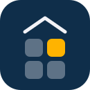
</p>

<h1 align="center">TileHouse</h1>

<p align="center">
  <b>A lightweight, HomeKit‑style Home Assistant dashboard for wall‑mounted Android tablets.</b><br>
  Native Android app · No WebView · Runs smoothly on old 2 GB tablets
</p>

<p align="center">
  <a href="https://github.com/gharl77/TileHouse/releases/latest"></a>
  
  
</p>

<p align="center">
  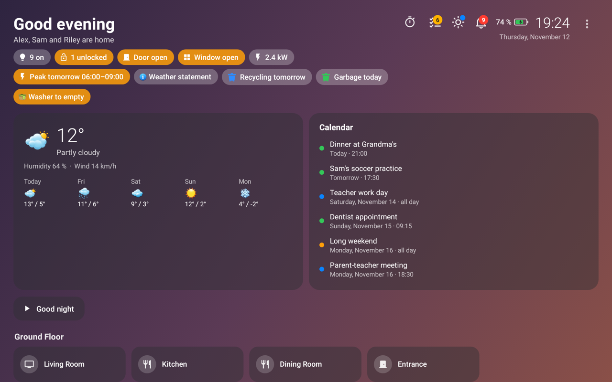
</p>

TileHouse turns an Android tablet into a kiosk panel for [Home Assistant](https://www.home-assistant.io/).
You build the dashboard **inside the app**: pick your rooms and devices, rename them for the tablet only, and get a clean, touch‑friendly
interface inspired by Apple Home. It is not a Lovelace dashboard in a browser: it is a native app written to stay fast and
memory‑light on aging hardware (developed on a Samsung Galaxy Tab A 10.1, SM‑T580, Android 8.1, 2 GB RAM).

> All screenshots on this page come from TileHouse's built‑in **demo mode**: a fictional house with invented devices.

---

## Contents

- [Highlights](#highlights)
- [Installation](#installation)
- [First setup](#first-setup)
- [Features in detail](#features-in-detail)
  - [Home screen](#home-screen)
  - [Safety alarms, everyday helpers and home health](#safety-alarms-everyday-helpers-and-home-health)
  - [Rooms](#rooms)
  - [Detailed controls](#detailed-controls)
  - [Cameras](#cameras)
  - [Notifications](#notifications)
  - [Kitchen timers](#kitchen-timers)
  - [Sleep, screen saver and sounds](#sleep-screen-saver-and-sounds)
  - [Header sensors](#header-sensors)
  - [Themes and wallpapers](#themes-and-wallpapers)
  - [Skins](#skins)
  - [Web configuration page](#web-configuration-page)
  - [Tablet settings](#tablet-settings)
  - [The tablet as a Home Assistant device (MQTT)](#the-tablet-as-a-home-assistant-device-mqtt)
  - [Demo mode](#demo-mode)
  - [Backup and restore](#backup-and-restore)
  - [Languages](#languages)
- [Updating over Wi‑Fi](#updating-over-wifi)
- [When Home Assistant is unreachable](#when-home-assistant-is-unreachable)
- [Security and privacy](#security-and-privacy)
- [Performance](#performance)
- [Building from source](#building-from-source)
- [Versioning](#versioning)
- [License](#license)

---

## Highlights

- **HomeKit‑style tiles** for lights, switches, plugs, fans, covers, locks, thermostats, media players, scenes, scripts, buttons and sensors.
- **Home screen** with greeting, weather and 5‑day forecast, calendar, who's home, and rooms grouped by Home Assistant floors.
- **Cameras** with periodic snapshots and a full‑screen **live view** (HLS or RTSP), including **PTZ by swiping**.
- **Camera alerts**: the live view pops up when a camera sees a person or when someone rings the doorbell.
- **Notifications from Home Assistant** in a card in the middle of the screen, with title, icon, colour and camera snapshot, and a
  **notification center** (bell with an unread counter) for the ones nobody confirmed.
- **Screen saver** with the time and weather (or a black screen), and optional **wake on motion** with the tablet's front camera.
- **Robot vacuums**: state, battery, start / pause / stop / return to base.
- **Music** with Music Assistant: favourites, playlists, radio and albums, on the speakers you choose, with volume, shuffle,
  repeat, queue and transfer to another speaker.
- **Scores** of your teams (TeamTracker), with the two logos, in the top bar and on the screen saver.
- **Kitchen timers**, **collection reminders** (recycling, garbage) and a **photo frame** screen saver (Immich).
- **Quiet hours**: silent notifications and, if you want, a black screen at night.
- **Smoke and carbon monoxide alarm**: full red screen and siren when a detector goes off, until someone silences it.
- **Family messages**: short notes pinned at the top of the home screen, written on the tablet or from the web page.
- **Everyday helpers**: tracked appliances (3D printer, washer, oven…), a good-night summary, a birthday banner, a screen-cleaning mode and a confirmation before unlocking a door.
- **Home health**: chips for low batteries and devices offline, only when there is a problem.
- **Two layouts** (*Appearance → Layout*): **Classic** — the home screen lists the rooms and the tools sit at the top right — or **Side navigation** — the rooms stay in a rail on the left, and in a room the camera and the players sit side by side, with idle players on a single line. Independent of the skin. With side navigation the home screen also shows previews of the tools (lists, running timers, the game in progress), your favourite devices as tiles and the cameras you choose (*Home → Home favourites*, *Tool previews* and *Home cameras* on the web page).

  | Side navigation: home | Side navigation: a room |
  |---|---|
  | 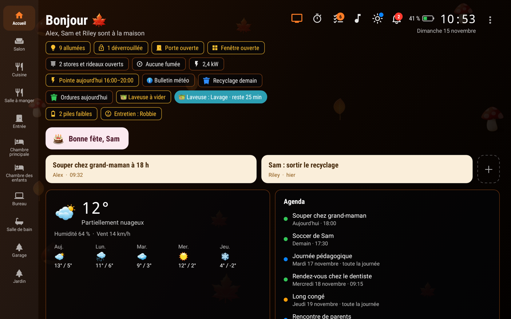 | 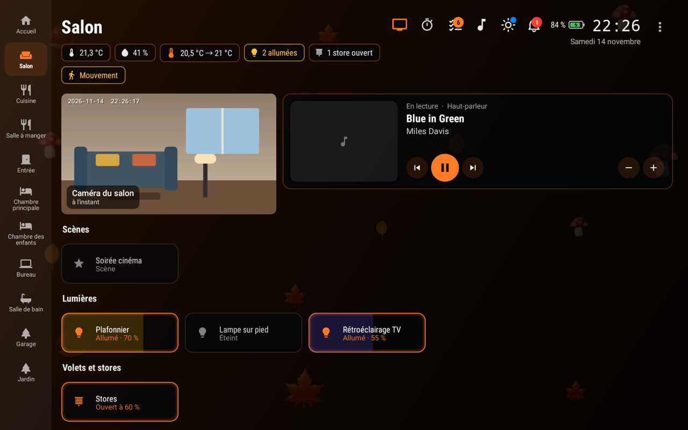 |

  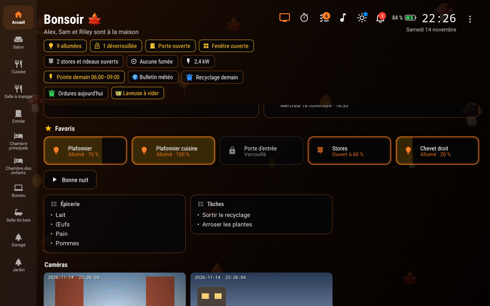
- **Sections shown**: hide what you do not use — weather, agenda, shortcuts, electricity chip, scores, timers, lists, Music, This morning — in the settings or on the web page (*Appearance → Sections shown*); a hidden section keeps its settings.
- **Header chips** summarising temperature, humidity, motion, doors, windows, blinds and curtains, leaks, smoke detectors and locks, tap for the details and quick actions.
- **Web configuration page** served by the tablet itself: set everything up comfortably from a computer or phone.
- **MQTT discovery**: the tablet shows up in Home Assistant as a device (battery, charging, screen, brightness, theme, notifications, updates…).
- **18 themes** for seasons and holidays, plus 5 wallpapers.
- **Updates over Wi‑Fi** from GitHub releases, from Home Assistant, or by uploading an APK.
- **English and French**, automatic by default.
- **Demo mode** to try everything without Home Assistant.
- Secrets (HA token, MQTT password, PIN, Immich, Music Assistant, TMDB and YouTube keys) **encrypted with the Android Keystore**.

---

## Installation

### What you need

| | |
|---|---|
| Tablet | Android **8.0 or newer** (API 26+). Tested on Android 8.1. |
| Home Assistant | Any recent version reachable on your network. |
| Optional | An MQTT broker (e.g. the Mosquitto add‑on) to expose the tablet in Home Assistant. |

### 1. Download the APK

On the tablet, open the [latest release](https://github.com/gharl77/TileHouse/releases/latest) in the browser and download
`TileHouse-<version>.apk`. (You can also download it on a computer and copy it to the tablet over USB.)

### 2. Allow the installation

Android blocks apps that don't come from the Play Store by default. When you open the APK, Android shows a prompt:

1. Tap **Settings** in the prompt.
2. Turn on **Allow from this source** for the app you used to open the APK (your browser or file manager).
3. Go back and tap **Install**.

> On Samsung tablets the setting lives under *Settings → Biometrics and security → Install unknown apps*.

### 3. Open TileHouse

The first screen offers two choices: **Open settings** to connect your Home Assistant, or **Try the demo** to explore with a fictional house.

### 4. Make it a kiosk (recommended)

In TileHouse: *Settings → Kiosk → Set as home app*, choose **TileHouse** and **Always**.
TileHouse now starts with the tablet, and the Home button always brings you back to it.

Other useful Android settings for a wall tablet:

- *Display → Screen timeout*: set it to the maximum. TileHouse keeps the screen on and dims it itself after the delay you choose.
- *Developer options → Stay awake* (while charging), if the tablet is always plugged in.
- Battery optimisation: exclude TileHouse so Android never stops it.

### Install from a computer (optional)

With [ADB](https://developer.android.com/tools/adb) and USB debugging enabled:

```bash
adb install TileHouse-<version>.apk
```

---

## First setup

1. **Create a long‑lived access token** in Home Assistant: click your profile (bottom left) → **Security** tab →
   **Long‑lived access tokens** → **Create token**. Copy it.
2. **Connect the tablet.** The easiest way is the **web configuration page**: TileHouse shows its address on the welcome screen
   (for example `http://192.168.1.42:8080`). Open it from a computer on the same Wi‑Fi, go to **Connection**,
   enter your Home Assistant address (for example `http://homeassistant.local:8123`) and paste the token.
3. **Add rooms.** Click **Import HA areas** to create one room per Home Assistant area with its main devices, or **+ Add a room** to build
   them by hand. Then pick devices from the list on the right.
4. **Set up the home screen** (weather, calendars, people) in the **Home** tab, and the floor order in the **Rooms** tab.
5. **Set a PIN** in **Security & backups** so nobody else on your network can change the configuration.

Everything can also be done directly on the tablet, from the ⋮ menu in the top‑right corner.

---

## Features in detail

### Home screen


- **Greeting** that follows the time of day (or the active holiday theme), with **who's home** underneath.
- **Weather card**: current condition, temperature, humidity and wind, plus a **5‑day forecast**
  (any `weather.*` entity, via `weather.get_forecasts`). **Tap it** for the next 24 hours, hour by hour: condition, temperature,
  feels-like temperature (when it differs by 2° or more), chance of rain and wind (when the weather source provides hourly
  forecasts). At night a moon replaces the sun, even when the weather source says "sunny" (from Home Assistant's `sun.sun`).
- **Calendar card**: upcoming events from the calendars you choose (today and the next few days), colour‑coded by calendar.
  **Tap an event** to see its end time, place and description, and to ask for a **reminder** (15 min or 1 h before, the day
  before at 7 pm; for an all-day event, the day before or that morning). The reminder arrives in the notification center with a
  sound, is kept on the tablet across restarts, and can be cancelled from the same window. A small bell marks the events
  that have a reminder.
- **Music** (♪ next to the lists, needs the Music Assistant integration): pick the Music Assistant speakers you want on the web
  page (*Tools & media → Music*); the icon appears and turns to the accent colour while one of them plays music from Music Assistant (not when the speaker
  is playing something else, such as AirPlay from a phone or the TV's sound; the window then marks it "Other source"). The window has the
  speakers on the left (**where to play**: tick one, or several to play together, each with its volume), the library on the
  right (favourites, playlists, radio, albums, and a search field) and what is playing at the bottom with shuffle, repeat
  (off, whole queue, one title), previous, pause and next, plus the title that comes next and the position in the queue
  ("Up next: … · 3 of 442"). A **progress bar** shows the position in the title; drag it to move. The **queue button** lists
  the titles to come (tap one to jump to it): Home Assistant does not expose the queue, so this asks the Music Assistant
  server directly and needs a token from Music Assistant, pasted on the web page (*Tools & media → Music → Queue*; the server
  address is guessed from Home Assistant's, port 8095, and can be changed there). Without a token everything else works.
  **Transfer** moves the music that is playing to another speaker, where it carries on from the same spot.
  When Music Assistant refuses a title, or a speaker accepts the music but does not start within ten seconds, the window says
  so in red instead of waiting. The covers are downloaded from the addresses Music Assistant gives, which are often your music
  service's servers on the internet.

  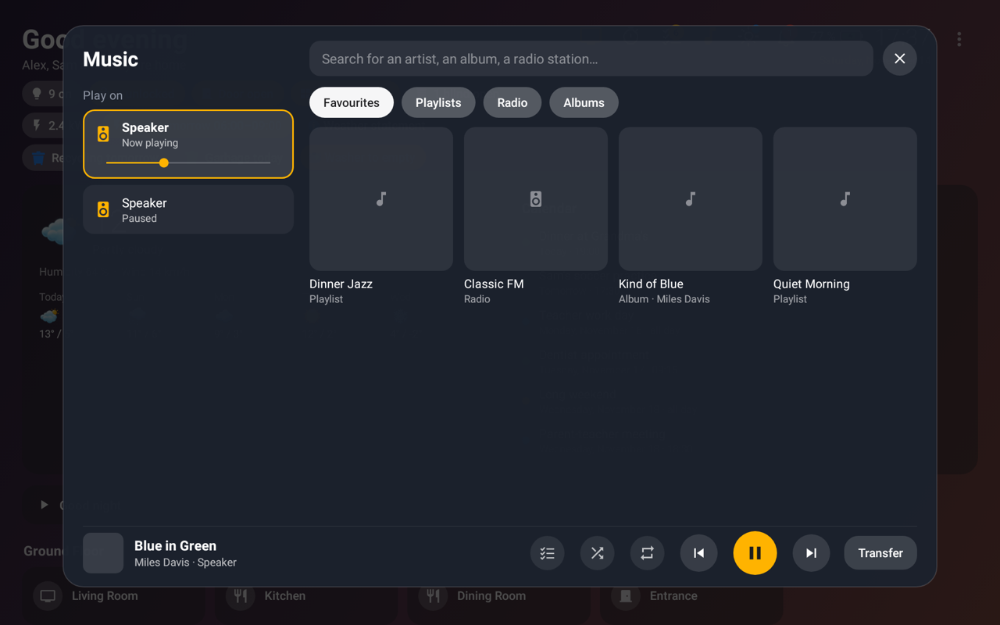

- **Scores** (🏆 in the top bar, needs Home Assistant's TeamTracker integration): pick the sensors of your teams on the web page
  (*Tools & media → Sports*). The icon appears when one of them is playing (it turns to the accent colour), starts within twelve
  hours or finished less than eight hours ago. Tap it for the two team logos with the score between them, the period and
  clock (or the start time, or "Final") and the last play. The **screen saver** shows the same score under the weather.
- **Shopping and to-do lists** (☑ next to the timer): the Home Assistant to-do lists you choose on the web page
  (*Tools & media → Shopping and to-do lists*) open from a header icon that shows how many items are left. Tick an item, add one with
  the keyboard, remove the ticked ones; several lists become tabs. Changes made elsewhere (phone, voice assistant) show up, and
  the other way round. A grocery list is sorted **by aisle** (fruit & vegetables, dairy, meat, bakery, frozen, drinks, pantry,
  household), recognised from common French and English words; a list that isn't groceries stays as it is. **Long-press an
  item** to remove it from the list, or to start a kitchen timer with its name ("Bread · 45 min").

  The weather window shows the active weather alerts first, then the next hours, then the **next days** with highs, lows and the
  chance of rain. Its **Radar** button shows the image of a radar camera of Home Assistant (for example Environment Canada's,
  to enable there), found by its name or chosen on the web page (*Home → Weather alerts*).

  | Lists | Weather window |
  |---|---|
  | 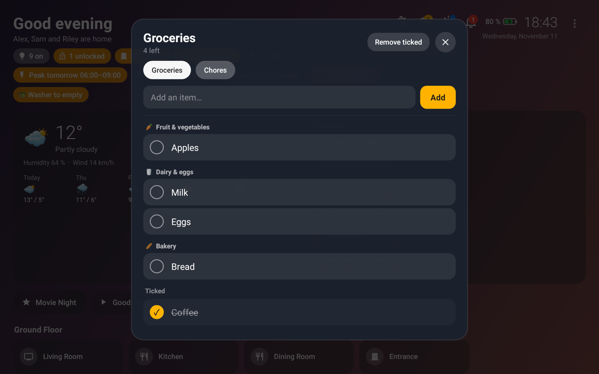 | 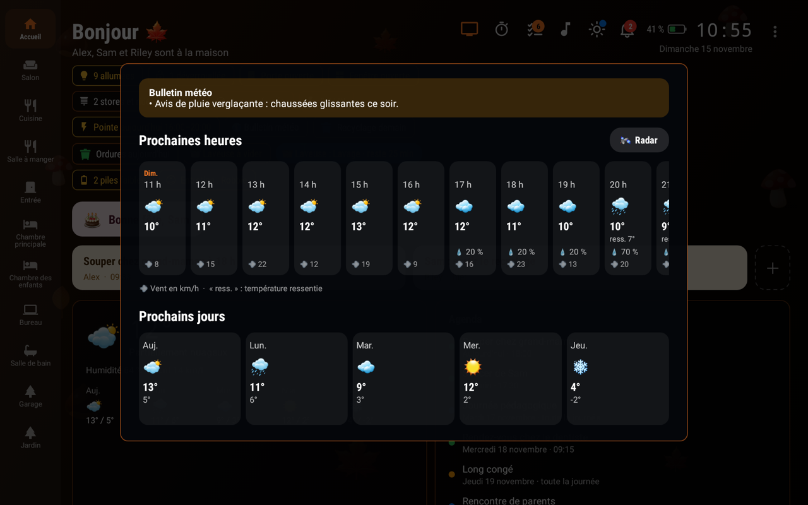 |

  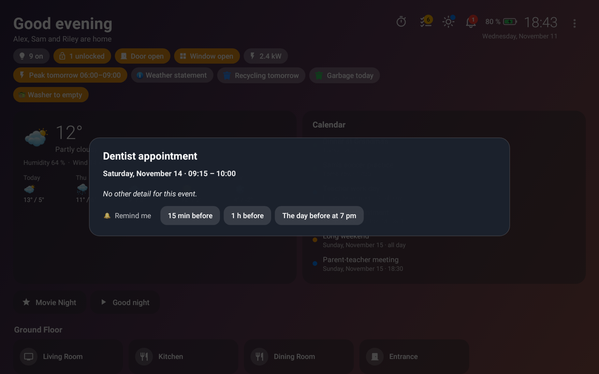
- **Header summary** for the whole house, showing only what needs attention: lights on, unlocked locks, open doors, open windows, open blinds or curtains
  (nothing at all when everything is off, locked and closed). Tap a chip to see which devices, with a **Turn off** / **Lock** button
  on each one that can be controlled.
  **You choose what counts** on the web page (*Home → Whole-house overview*): the lights, locks, doors, windows and blinds or curtains of your rooms
  are listed by kind with their room, all ticked at first. Untick a device and it no longer counts (an inside door that is
  always open, a night light); untick a whole kind and its chip disappears. Appliance doors (fridge, freezer, washer…) and the
  door state published by a lock are **unticked by default**, marked as such in the list; tick them again if you want them.
- **Rooms by floor**: rooms are grouped using your Home Assistant floors, in the order you choose. Rooms without a floor appear under *Other rooms*.
- **Collection reminders**: "Recycling tomorrow" (blue bin) or "Garbage today" (green bin) chips. On the web page
  (*Home → Collections*) pick a calendar and a keyword for each: an event counts when its title contains the keyword
  (case and accents ignored; empty = every event of that calendar). Both can use the same calendar.
- **Electricity peaks** (e.g. Hydro-Québec): "Peak tomorrow 06:00–09:00" the day before and the same day, then a red "Peak now ·
  ends 09:00" during the peak, from the calendar you pick (*Home → Electricity*). An optional reminder (30 min to 3 h
  before) goes to the notification center.
- **Electricity**: tick power or energy sensors on the web page (*Home → Electricity*). The first one makes a chip ("2.4 kW";
  for an energy meter that only counts up, the consumption since midnight — "42 kWh today" — or, when the meter is read once a
  day like Hydro-Québec's, yesterday's consumption, since today's stays at zero: "65 kWh yesterday"). In a room, the tile of a power or energy
  sensor opens the same window with that sensor's curve. Tap the chip, or the peak chip, for the **Electricity window**: the peak in progress or coming, every ticked sensor, and the last
  24 hours of the first one (a curve for a power sensor, consumption per hour for an energy meter). A meter that is read
  once a day, like Hydro-Québec's, shows the **last 14 days** instead, one bar per day, with the daily average.

  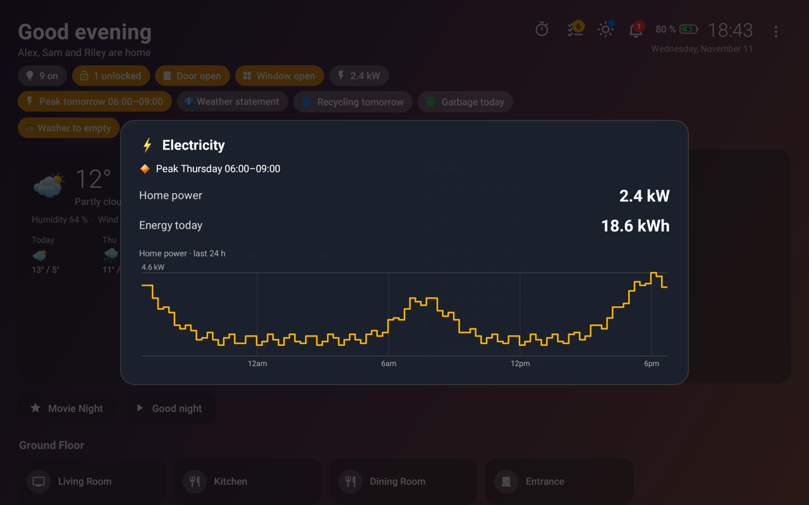
- **Weather alerts**: pick the sensors that count the alerts in effect (Environment Canada: warnings, watches, advisories); a chip
  appears when one is above 0 (red for a warning), tap it for details.
- **Custom chips**: show a chip when an entity is in a given state, e.g. "🧺 Washer to empty" when the washer status is *To empty*.
  On the web page (*Home → Custom chips*) each chip is shown as it will look, with its rule in plain words; open it to edit:
  - the **states** are picked from the ones the entity can really take (the options of a drop-down helper, plus its current
    state), with a field for any other state;
  - an **icon** from a set of about fifty that the tablet can draw, with a search by name; each shows its Unicode code
    (`U+1F9FA` for the laundry basket). Any other emoji can be pasted at the start of the text — the tablet (Android 8) draws
    those up to [Emoji 5](https://emojipedia.org/emoji-5.0);
  - a **colour** among nine: neutral, orange, red, yellow, green, teal, blue, purple and pink. Orange and red are alerts and
    come before the other chips.
- **Shortcuts**: large buttons for the scripts, scenes and buttons you choose. A shortcut shows **in the room it
  belongs to, under the cameras** — the room of its Home Assistant area, or the one you pick next to it on the web page (*Home → Shortcuts*) — and
  stays on the home screen when it has no room (or when you pick *Home*). A scene that already has its tile in the room isn't
  shown twice.
- **This morning** (☀️ next to the bell): during a time range (default 05:00–10:00), a sun icon appears at the top, with a blue
  dot until you have read the content. Tap it to open a full-screen panel with the sources you choose (*Tools & media → This morning* on
  the web page):
  - **News feeds**: a title and the link of any RSS or Atom feed (XML). The tablet reads the feed itself (no Home Assistant
    integration needed) and shows the stories in two columns, with picture, title, start of the summary and time
    ("2 h ago"); tap a story to read its whole summary. Choose how many stories (4–12). The **Test** button checks the link.
    Feeds are re-read every 20 minutes; a feed that doesn't answer keeps its last stories. Suggestions in one tap: Radio-Canada,
    La Presse, Le Devoir, Journal de Montréal, Journal de Québec, TVA Nouvelles.
  - **Texts**: the state or an attribute of an entity (Markdown), e.g. the sections of a morning summary generated in Home
    Assistant, shown as cards side by side.

  The dot comes back when a source changes (a new story or a new summary).

  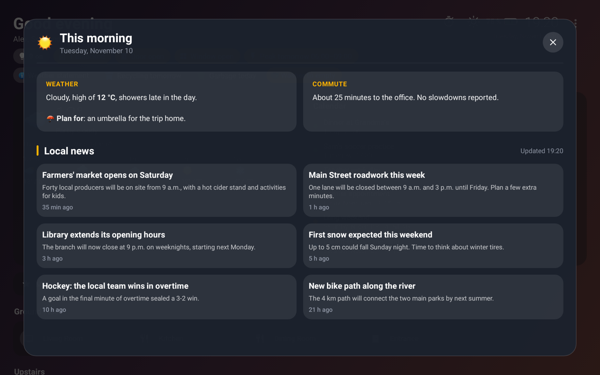

- **Kitchen timers** (⏱ next to the time), **This morning** (☀️) and the **notification bell** with the number of unread notifications — see
  [Kitchen timers](#kitchen-timers) and [Notifications](#notifications).
- **Clock and date** (optional) in the top‑right corner, with the **tablet's battery** next to the time (optional; green with a bolt
  while charging, red under 20 %).
- After 3 minutes in a room, the tablet returns to the home screen by itself.

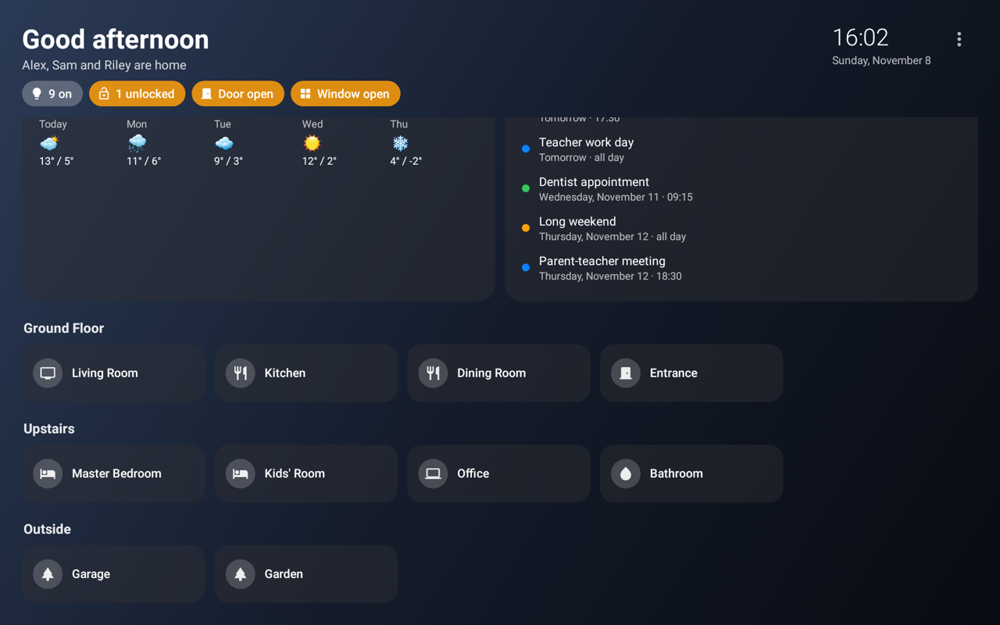

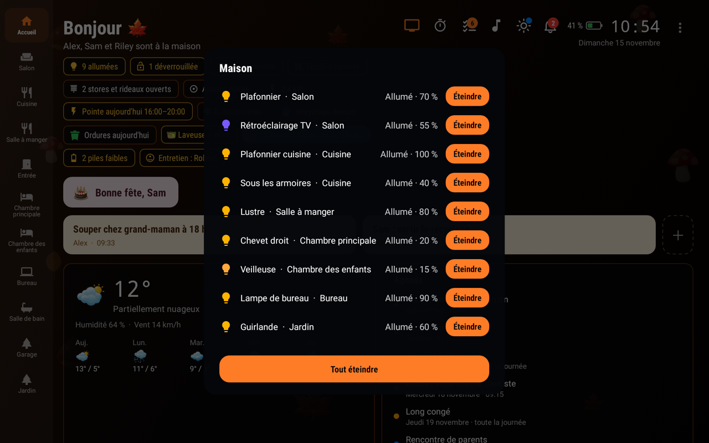

The details of the *lights on*, *blinds open* and *unlocked* chips end with one button: **Turn all off**, **Close all** or
**Lock all**. It only ever turns off, closes or locks, and disappears once there is nothing left to do.

**Who's home** accepts several kinds of entities, so it works with any presence setup:

| Entity | Counts as "home" when… |
|---|---|
| `person.*` (companion app) / `device_tracker.*` | state is `home` |
| `binary_sensor.*`, `input_boolean.*` | state is `on` |
| Room‑presence sensors (ESPresense, Bermuda…), e.g. `sensor.riley_presence` | state is anything but an absence (`not_home`, `away`, `unknown`…) |

### Safety alarms, everyday helpers and home health

**Safety alarms.** When a smoke, carbon monoxide or gas detector placed in a room turns on, the tablet wakes up, sounds a siren
and shows a full red screen with the detector, its room and the time, until someone taps *Silence the alarm*. A **water leak**
detector does the same in blue, with a softer two-beep sound. Both ignore quiet hours and the notification sound switch, come in
front of the settings or a camera, and leave an entry in the notification centre. If the tablet's alarm volume is at zero, a real
alarm raises it. *Test the alarm* (tablet and web page, *Alerts & sounds*) shows the same screen with the same sound.

| Smoke or carbon monoxide | Water leak |
|---|---|
| 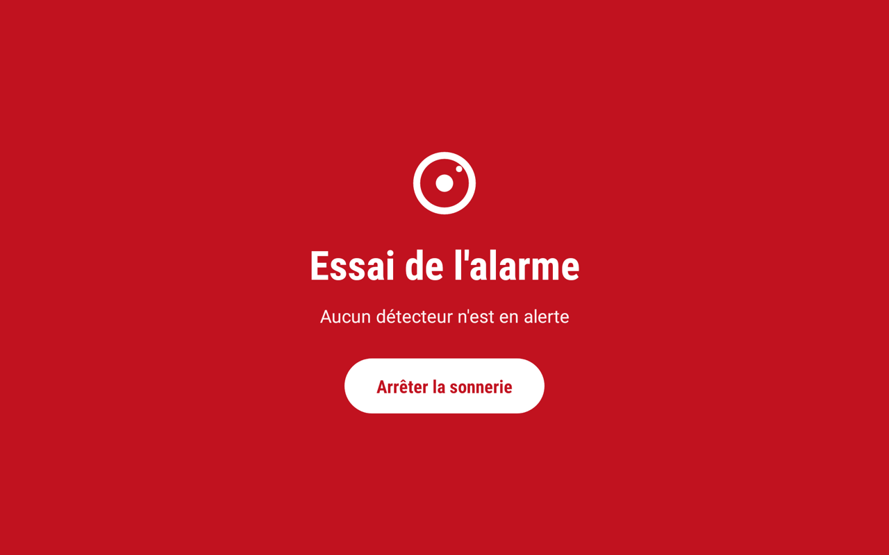 | 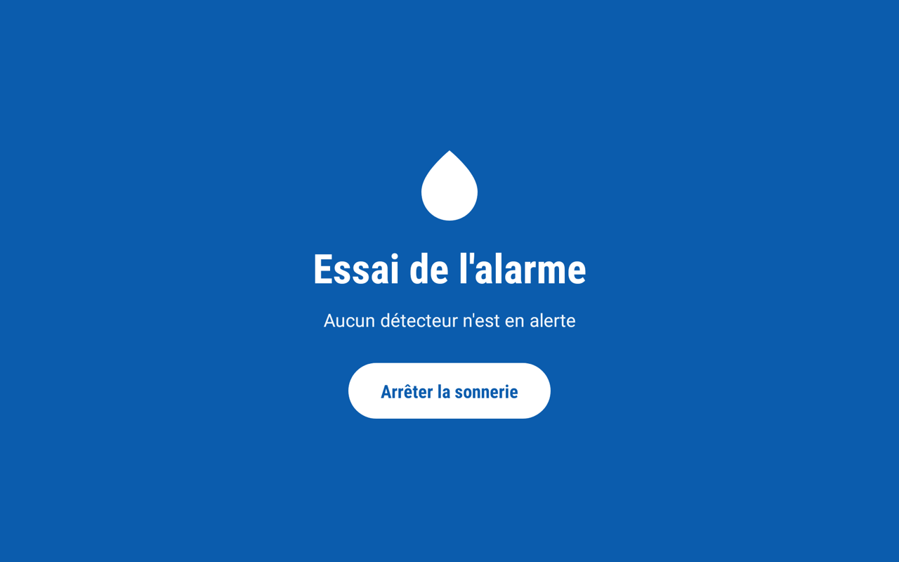 |

**Confirm before unlocking.** Tapping a locked lock (its tile, or its line in the chip details) asks *Unlock?* with the name of
the door. Nothing is sent without the second tap, and the window closes by itself after 15 seconds. Locking stays immediate.

**Family messages.** Short notes pinned at the top of the home screen ("Dinner at grandma's at 6"). Write one on the tablet with
the **+** (keyboard, who signs it, and how long it stays: until midnight, until tomorrow night, or until erased) or from the web
page (*Home → Family messages*). Tap a note to read it in full or erase it. Up to six notes; they stay on the tablet.

| Unlock confirmation | New family message |
|---|---|
| 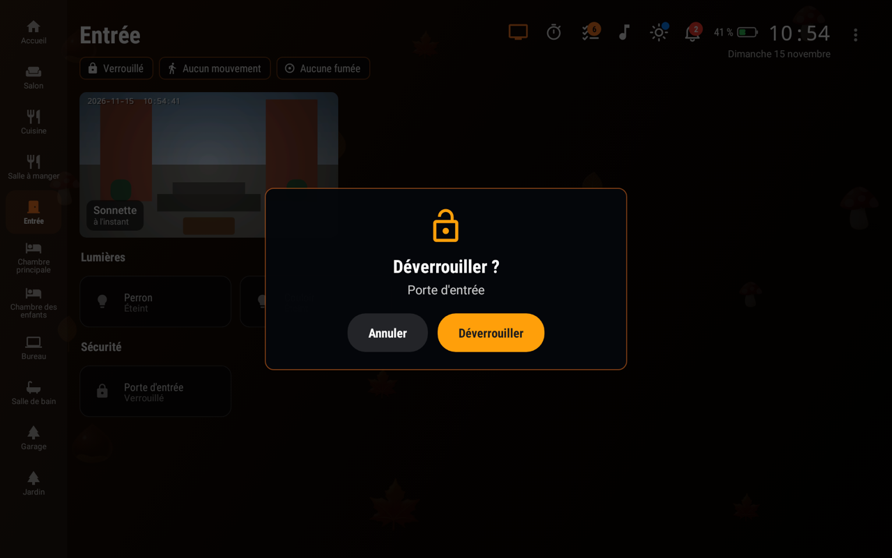 | 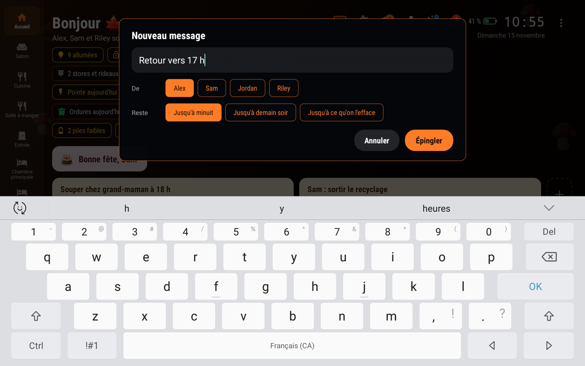 |

**Tracked appliances.** A 3D printer, a washer, an oven: give the entity that holds the appliance's state (web page, *Devices &
health*); progress, time left, job name and an image (a camera or an image entity) are optional. Attached to a room, the appliance
has a card there, always visible, with its picture, the job, a progress bar and the time left. Without a room, it makes a chip on
the home screen only while it is working ("Washer: Washing · 25 min left"). Idle states (`idle`, `off`, `initial`, `finish`,
`Inactive`…) are recognised automatically, and each appliance can send a notification when it has finished.

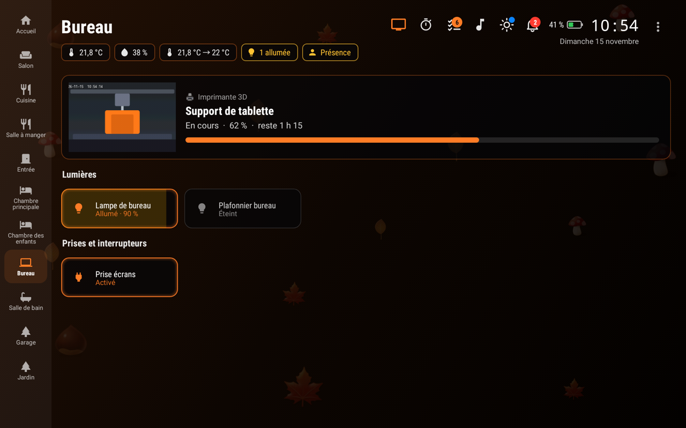

**Good-night summary.** Ten seconds after the *Good night* shortcut is tapped on the tablet, a window lists what is still on,
unlocked or open, with *Turn off*, *Lock* and *Fix everything*. If nothing is left it says so and closes by itself. The shortcut
is recognised by its name, or chosen on the web page (*Home → Shortcuts*).

**Birthday banner.** On the day of an event in your birthday calendar, a banner shows at the top of the home screen: an event named
with a first name gives "Happy birthday, Léa"; a title that already mentions a birthday is shown as is. The calendar is found by
its name, or chosen on the web page (*Home → Calendar*).

**Screen cleaning.** Long-press the clock (or the date): the touch screen is frozen for 30 seconds, with a countdown, so the tablet
can be wiped. Hold a finger still on the panel for 3 seconds to finish early.

| Good-night summary | Screen cleaning |
|---|---|
| 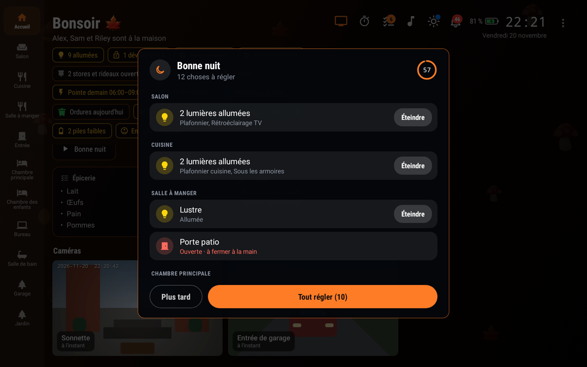 | 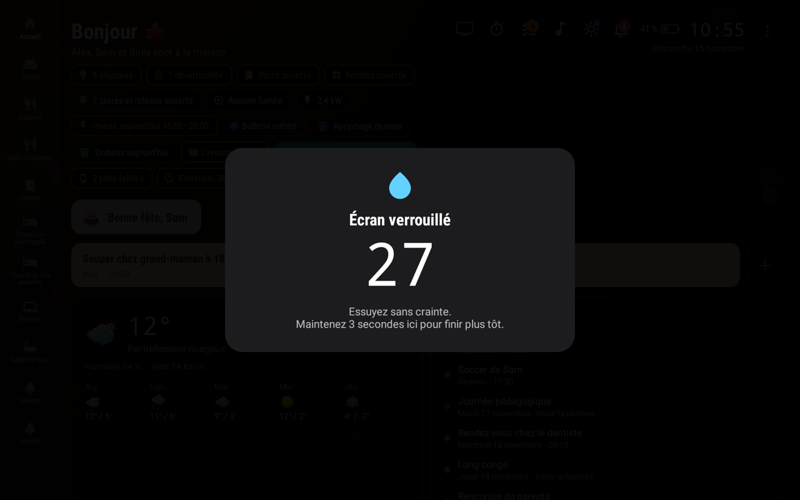 |

**Home health.** Chips that exist only when there is a problem, each with its list on tap: **low batteries** (every battery of the
house at or below a level you choose; phones and tablets are not counted), **devices offline** (devices of your rooms that Home
Assistant can no longer reach; players and cameras are not counted) and **vacuum maintenance** (a filter, a brush or the water
tank of a vacuum that exposes them, such as Dreame, near the end of its life).

**Temperature and humidity history.** In a room, tap the temperature or humidity chip to see the last 24 hours as a curve, with
the current value, the minimum and the maximum.

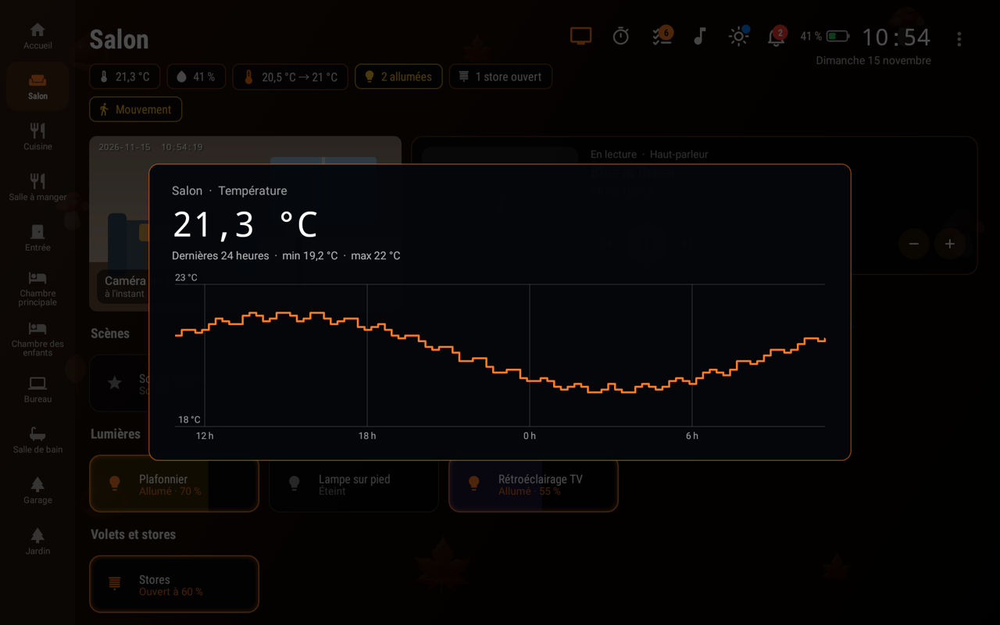

### Rooms

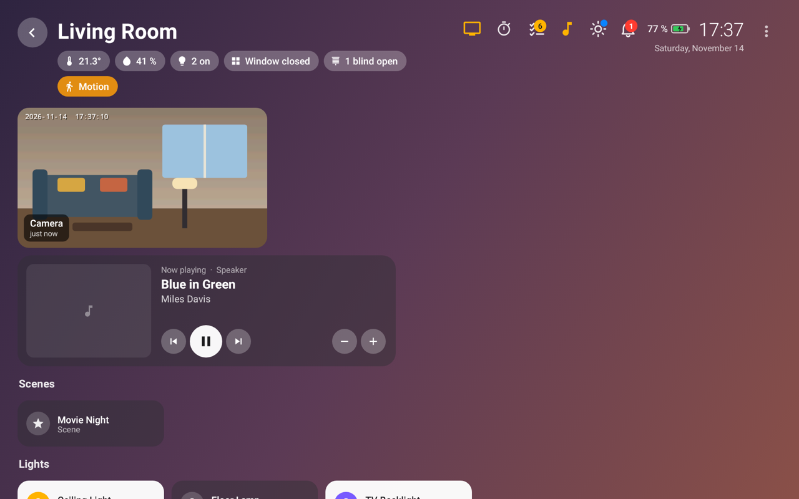

- Tap a room on the home screen to open it; the **←** arrow brings you back. **Swipe left/right** to move between rooms.
- **Order of a room**: the cameras always come first, then the shortcuts of the room, then the player cards, then the tiles.
- **Player cards**: every speaker or TV of a room has a card instead of a tile. The card is always there: sober, in a quiet slate tone, when the player is off or
  idle (with a button to turn it on, and its applications), and while it is playing it shows the **poster**, the title, the show or
  artist (with season and episode when the player gives them), the app, a progress bar you can drag when the player gives a
  duration, pause, previous, next, volume, an **applications** button for a player that lists them (an Apple TV: tap one to launch
  it) and, for a player that can be turned off, a power button. The card takes half the width of the room, so two players sit side
  by side. A **TV icon in the top bar** appears while a player is playing; tap it to see the poster in large with the title.
  When several players are playing, the icon shows how many and the window shows all their posters side by side, each with
  its title and its player (up to four, the most recent first; turn the icon off on the web page, *Tools & media → Now playing*). The image frame always has the same size, in the card and in the window; the image fills it, cropped at the edges when its shape differs (a portrait poster, a square cover); only a logo is shown whole. From TMDB the wide image of the show is preferred to the portrait poster. **Where the picture comes from**:
  for **music**, the **artist's photo**, looked up by name on Deezer's public search (the cover Home Assistant gives is used when no photo is found); for everything else, the image Home Assistant gives when there is one; for YouTube, the thumbnail of the video (when the player only gives the
  title and the channel, as an Apple TV does, the tablet looks them up on YouTube's search page and takes the first video;
  this is not an official interface and may stop working, and an optional YouTube Data API key makes it use the official
  search instead); for a **game**, when the title names two teams of the same league (NHL, NFL, NBA, MLB, MLS; English
  nicknames and the usual French ones), their **two logos** side by side, from ESPN's public team lists; otherwise a search
  by title on TVmaze (shows) and iTunes (films, music, podcasts). An optional TMDB key gives better film and series posters
  (test it with the button next to the field). **Live TV** (Bell Fibe TV on an Apple TV gives the programme title and the
  channel code): the card shows the channel — and its number once you have typed it on the web page (*Tools & media → Now playing → TV channels*:
  Fibe gives a code, not the number; the codes already seen are listed there) —, the search also tries the part of the title before a dash ("Series - Episode"),
  and when nothing is found the **channel's logo** is shown, from a public collection of Canadian channel logos.
  A **log** on the web page (*Tools & media → Now playing → Log*) lists the last titles as each player reported them and where the
  poster came from, to understand why one is missing; it stays on the tablet.
  A search by title can pick the wrong poster, or none; the card then keeps an icon. The search sends the title of what is
  playing to those sites: untick *Look for the poster on the internet* to keep to Home Assistant's image. The home screen doesn't show the cards. **You choose which players have a card** on the web page (*Tools & media → Now playing*): every speaker and TV of your rooms is listed and ticked at first, except voice assistants, which "play" at every answer; untick one and it goes back to being a plain tile.
- Devices are shown as tiles, **grouped by category** (Cameras, Scenes, Lights, Climate, Blinds & shades, Media, Plugs & switches,
  Security, Sensors…), or in your own order if you turn grouping off.
- A speaker or TV that is on but playing nothing (an Apple TV on its home screen) shows **Inactive**, which is why it has no
  *Now playing* card.
- **Tap** a tile to toggle it (light, switch, cover, lock, scene, media play/pause…). Active tiles turn white with a coloured icon,
  just like Apple Home; coloured lights use their real colour.
- **Long‑press** a tile for detailed controls.
- Long names wrap onto two lines instead of being cut.
- Names are shortened automatically: *Living Room Ceiling Light* becomes *Ceiling Light* inside the Living Room. You can also give any
  device a custom name **for the tablet only** (Home Assistant is never modified).

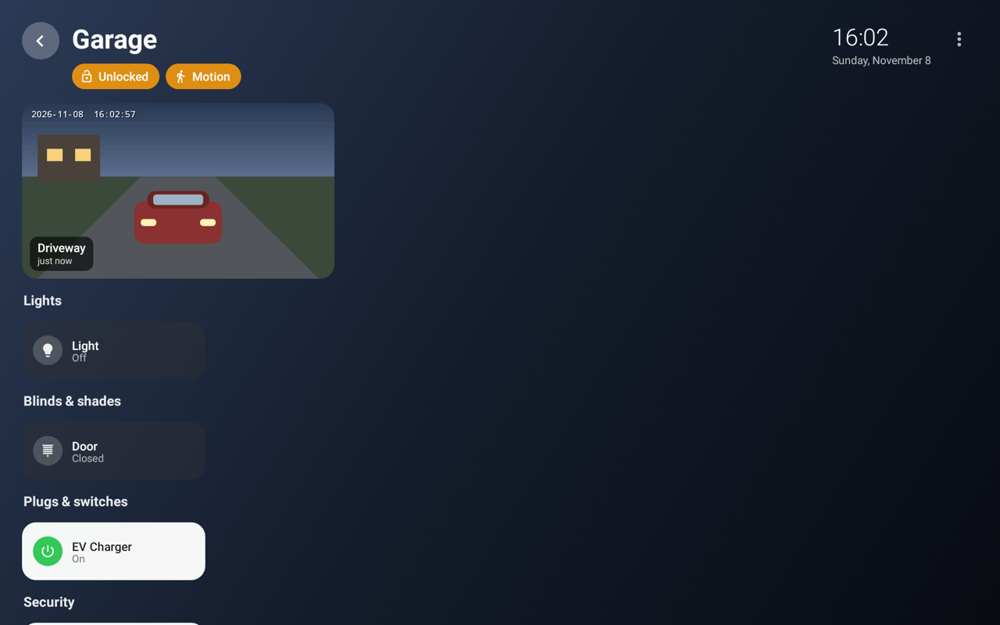

### Detailed controls

Long‑press a tile to open its control panel:

| Light: brightness slider | Thermostat: target in its arc, current temperature |
|---|---|
| 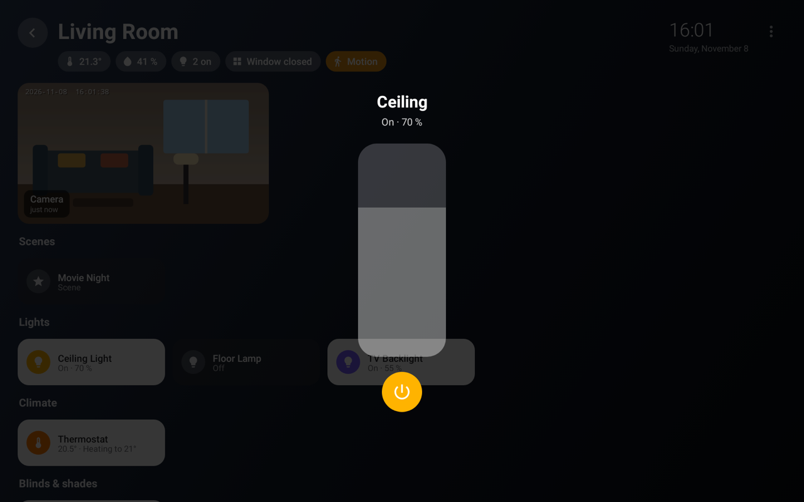 | 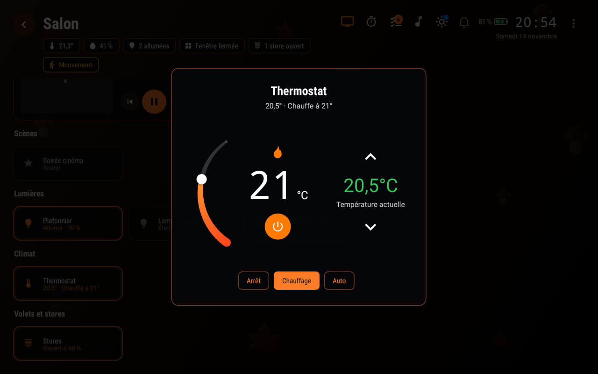 |

| Blind: comes down from the top | Curtain: closes from both sides |
|---|---|
| 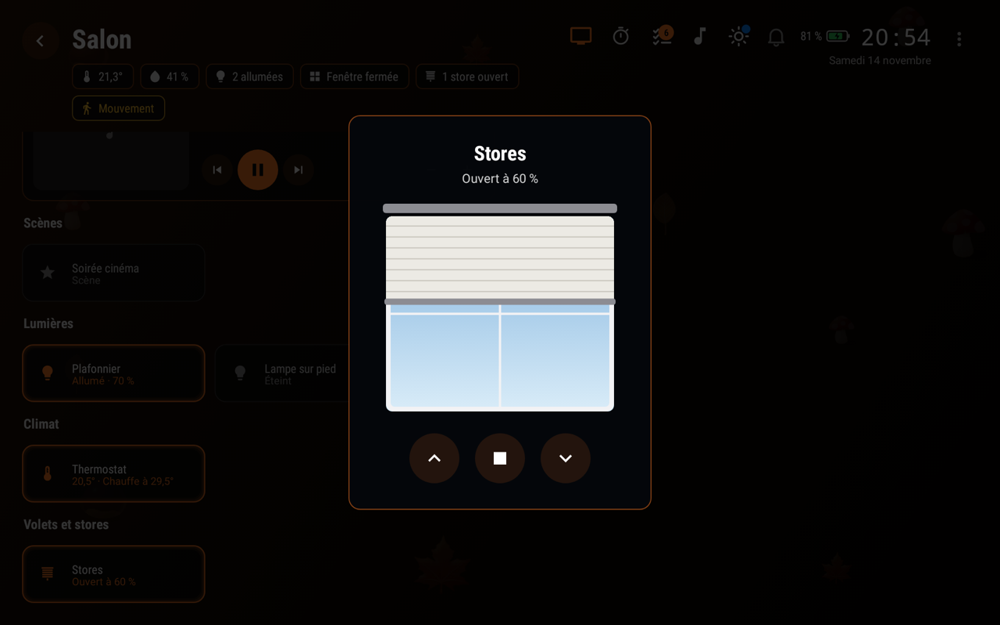 | 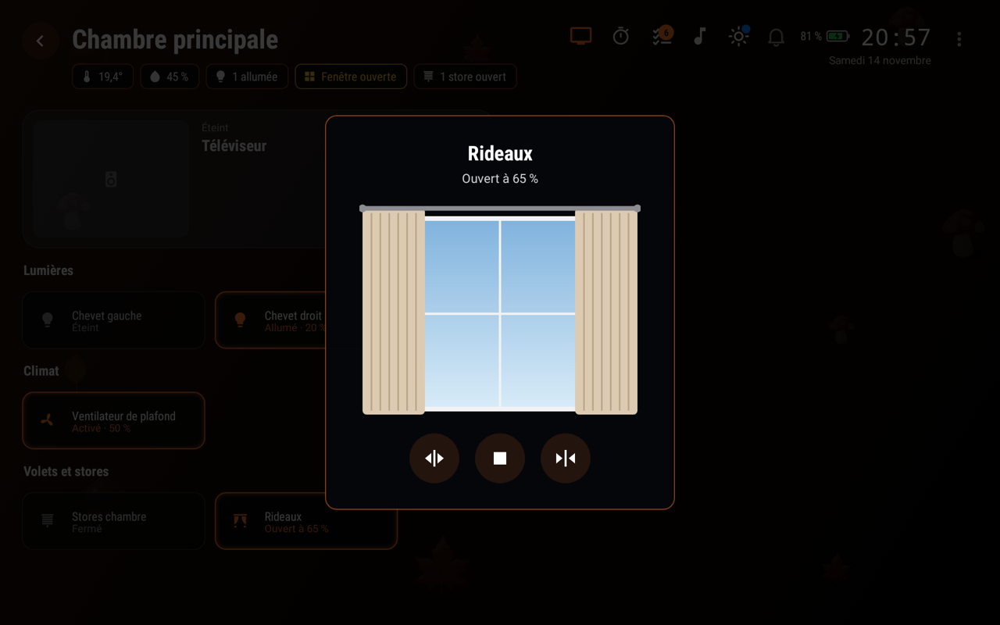 |

- **Lights**: large vertical brightness slider and power button. A dimmable light can also be set straight from its tile:
  **slide left or right on the tile** and the level fills it; release to apply (all the way left turns it off).
- **Fans**: speed slider.
- **Blinds, shades, shutters and curtains**: a drawn window shows the real position: a blind comes down from the top, a
  curtain closes from both sides (device class `curtain`, or a name with "rideau" / "curtain"). Drag in the drawing to
  set the position; open / stop / close buttons below (up and down arrows for a blind, sideways arrows for a curtain).
  Stop and the drag only appear when the cover supports them.
- **Thermostats** are a chip at the top of their room (current temperature → target), not a tile, and are not shown on the home screen; a tap on the chip opens the card: the target in large inside an arc you can drag, a flame (or a snowflake) that
  lights up while it really heats or cools, and an on/off button; on the right, the current temperature between the
  two arrows that raise and lower the target (step taken from the entity). Mode pills are shown only when there is
  more than one mode besides off.
- **Media players**: volume slider, previous / play‑pause / next and power.
- **Robot vacuums**: the tile shows the state and battery; tap it for Start / Resume, Pause, Stop and Return to base. For a vacuum
  whose integration lists its rooms (Dreame), the rooms appear as chips: pick some, then *Clean N rooms*.

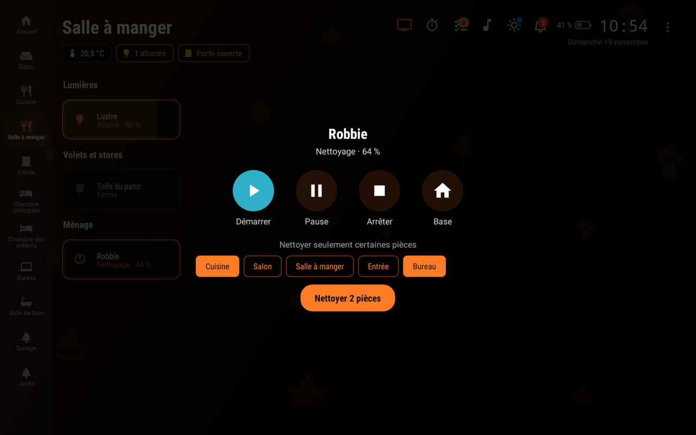

### Cameras

- Every camera in a room shows its **latest snapshot**, refreshed every minute while visible.
- Battery cameras that can't produce a snapshot on demand (some Eufy models, for example) fall back to the camera's latest event image
  from Home Assistant.
- **Tap a camera** for a full‑screen **live view**. TileHouse tries the camera's own **RTSP** stream first when the integration
  publishes one, then Home Assistant's **HLS** stream. Hardware decoding is used; 1080p streams are recommended on older tablets.
- **PTZ cameras**: **swipe** on the live view to pan or tilt. TileHouse finds the camera's PTZ buttons
  (e.g. `button.<camera>_pan_left`) or uses the **ONVIF** `onvif.ptz` service.
- The live view closes itself after 5 minutes so a stream is never left running.
- **Eufy**: when a camera's `switch.<camera>_rtsp_stream` is off, TileHouse turns it on for the live view, waits for the stream
  address, and turns it off again afterwards.
- **Person alert** (Display → Cameras): when a room camera detects a person, its live view opens full screen for 20 seconds
  (10–60 s) with a red "Person detected" banner. Detections come from `event.<camera>_detection` entities (`event_type: person`)
  or `binary_sensor` person detectors. Option: *Trigger on person only / any motion*. The countdown starts with the first video
  frame; touching the screen keeps the live view open.
- **Doorbell alert**: when someone rings a doorbell camera (`event.<camera>_doorbell` ring, or `binary_sensor.<camera>_ringing`),
  its live view opens with a "Someone is at the door" banner.

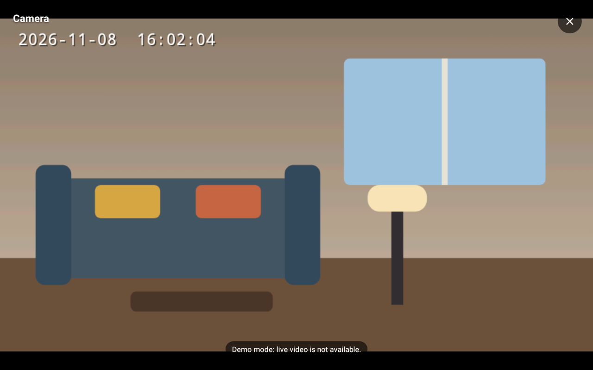

### Notifications

Home Assistant can show messages on the tablet with the **Message** notify entity of the tablet (see
[MQTT](#the-tablet-as-a-home-assistant-device-mqtt)). A message appears in a card in the middle of the screen, wakes a dimmed screen,
and closes after the notification duration or with **OK**.

Example:

```yaml
action: notify.send_message
target:
  entity_id: notify.kitchen_tablet_message
data:
  message: "Dinner is ready! 🍝"
```

For more, send a JSON object as the message (Home Assistant's MQTT notify entity only passes the message text, so the title
goes inside it):

```yaml
action: notify.send_message
target:
  entity_id: notify.kitchen_tablet_message
data:
  message: >-
    {"title": "Laundry done", "message": "The washer finished its cycle.", "icon": "🧺",
     "color": "green", "duration": 45, "image": "camera.front_door", "sound": true}
```

| Key | Meaning |
|---|---|
| `title` | bold title |
| `message` | text |
| `icon` | an emoji, shown in a coloured circle (default 💬) |
| `color` | accent colour: `red`, `orange`, `yellow`, `green`, `blue`, `purple`, `amber` or `#RRGGBB` |
| `duration` | seconds before it closes (default and maximum: the tablet's notification duration, 30 s unless changed) |
| `image` | a camera or image entity whose snapshot is shown in the card |
| `sound` | `true` plays the tablet's notification sound (not during quiet hours, except red alerts) |
| `tag` | replaces an older notification with the same tag; with the message `clear_notification`, removes it |
| `actions` | up to 3 buttons next to **OK**: `[{"title": "Lock", "service": "lock.lock", "entity_id": "lock.front_door"}]` (optional `data`). Tapping one calls the service and marks the notification read |

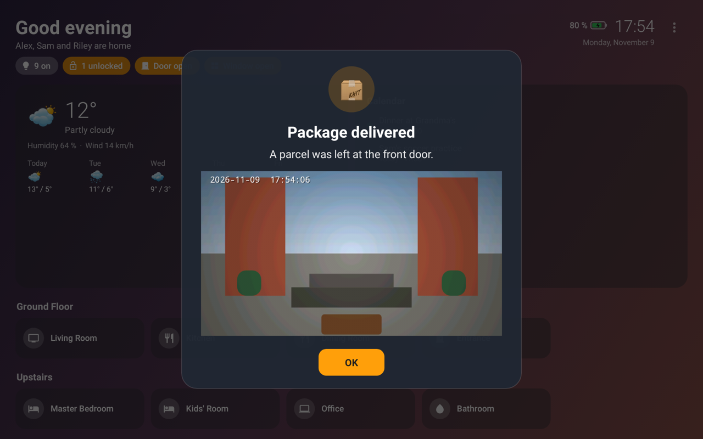

**Notification center.** A notification stays on screen for at most **30 seconds** (configurable in *Sleep & sounds → Notifications*,
on the web page, or with the number entity *Notification duration*; a shorter `duration` from the automation wins). If nobody taps
**OK**, it stays **unread** and a **bell** with a red counter appears next to the time. Tap the bell to see every unread
notification, newest first:

- tap one to open it again (it becomes read and leaves the list);
- **Select** (or long‑press a notification), tick several, then **Mark as read**;
- **Mark all as read**.

**Tags.** Add `"tag": "leon_stuck"` to a notification: a new one with the same tag replaces the old one, and sending the message
`clear_notification` with that tag removes it from the tablet, like the companion app does on phones (e.g. when the vacuum is back
on its base). With the helper script below, use its `tag` field.

**Camera alerts** (person detected, doorbell, motion) are kept in the notification center too, like Home Assistant's camera
notifications but without a description: the camera name, the time and a **thumbnail** captured a few seconds after the
detection. Open one to see the capture large. There is at most one entry per camera and type per minute, and the capture is
deleted from the tablet when the alert leaves the history.

Unread notifications are kept across restarts and updates (50 at most). The sensor *Unread notifications* gives their number to
Home Assistant, e.g. to light a lamp while messages are waiting. Emoji newer than the tablet supports are shown as 💬.

**History**: the last 20 notifications you have read are kept too. While there are some, the bell stays in the header (dimmed,
without a counter); the **Read** button of the notification center lists them, and tapping one shows it again. **Clear history**
empties the list, and `clear_notification` with a tag removes that notification from the history as well.


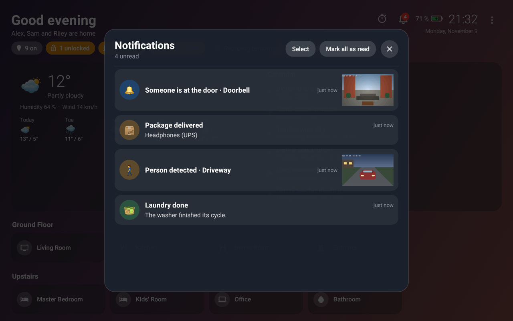

**A helper script** keeps automations short. Create it once in Home Assistant (*Settings → Automations & scenes → Scripts*, YAML mode),
replacing the notify entity with yours:

```yaml
alias: Notify the tablet
mode: parallel
fields:
  message: {required: true, selector: {text: {multiline: true}}}
  title: {selector: {text: null}}
  icon: {selector: {text: null}}
  color: {selector: {text: null}}
  duration: {default: 30, selector: {number: {min: 0, max: 3600}}}
  sound: {default: false, selector: {boolean: {}}}
  tag: {selector: {text: null}}
  actions: {selector: {object: {}}}
sequence:
  - action: notify.send_message
    target:
      entity_id: notify.kitchen_tablet_message
    data:
      message: >-
        {{ {'title': title | default(''), 'message': message, 'icon': icon | default('💬', true),
            'color': color | default('amber', true), 'duration': duration | default(30) | int(30),
            'sound': sound | default(false) | bool, 'tag': tag | default(''),
            'actions': actions | default([], true)} | to_json }}
```

Then, in any automation:

```yaml
- action: script.notify_the_tablet
  continue_on_error: true   # never block the automation if the tablet is off
  data:
    title: Laundry done
    message: The washer finished its cycle.
    icon: 🧺
    color: green
```

With a button:

```yaml
- action: script.notify_the_tablet
  continue_on_error: true
  data:
    title: Front door
    message: Could not lock after 5 tries.
    icon: 🔒
    color: red
    actions:
      - title: Lock
        service: lock.lock
        entity_id: lock.front_door
```

### Kitchen timers

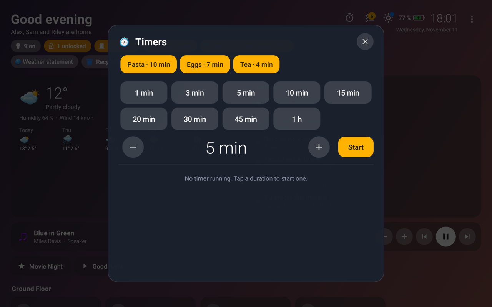

- Tap **⏱** next to the time, then a quick duration (1 min to 1 h) or set your own with − / + and **Start**.
- **Favourite timers**: named timers started with one tap ("Pasta · 10 min"), set on the web page (*Tools & media → Favourite
  timers*). The name shows in the list and on the card when it rings.
- In Home Assistant: the sensors *Running timers* and *Next timer ends*, and the event *Timer finished* (with the timer's name),
  e.g. to announce on a speaker elsewhere that the pasta is ready.
- Several timers can run at once; each has **+1 min**, pause / resume and cancel. The next one to end counts down in the header
  (e.g. `4:32 +1`).
- When a timer ends, the screen wakes up, an **alarm** rings (up to 2 minutes, at the tablet's alarm volume) and a large card stays
  until you tap **OK**. Timers ring even when notification sounds are off or during quiet hours: you started them yourself.
- If the settings or a camera's live view are open at that moment, the dashboard comes back to the front with the card, so the
  **OK** button is always there to stop the alarm.
- The alarm uses Android's **alarm volume** (*Android settings → Sounds → Volume → Alarm*). If it is at 0, timers would be
  silent: the timers window then shows a warning with a **Turn it up** button.
- **Long-press an item of a list** to start a timer with its name (or to remove the item).

### Sleep, screen saver and sounds

Everything here is in the tablet's **Sleep & sounds** tab and on the web page (*Display*).

**Screen saver:** after the idle delay the screen shows the **time, date and current weather** (moving a little every
minute so nothing burns in, at a brightness you choose, 1–60 %), a **photo frame**, or a **black screen**. A touch wakes it.
Under the time and the date, a row of roomy panels shows the weather, the **score** of the teams you follow (the two logos, up to two games) and **what
is playing** (a small image, the title, the player, the app and the channel), and when several players are playing they take turns every ten seconds.
The photo frame shows an **Immich** album or your favourites, changing photo every 30 seconds (10 s to 5 min), with the time and
weather in a corner. TileHouse talks to Immich directly with its own API key: on the web page (*Screen & sleep → Screen saver → Photo
frame*) enter the Immich address (e.g. `http://192.168.1.20:2283`) and an API key (Immich → *Account settings → API keys*; read
access to albums and assets is enough), then pick the album. The key is encrypted on the tablet and never shown again. Only photos
are shown (videos are skipped), in Immich's "preview" size.

**Notification sounds:** turn it off and no notification makes a sound, at any time. Timers still ring, since you
started them yourself.

**Quiet hours** (default 22:00–07:00): notifications make no sound, except red alerts (leak, lock, window…), and the
screen saver is black whatever style you chose (uncheck *Black screen saver during quiet hours* to keep the clock or the
photos and only mute the sounds). Also available as the switch *Quiet hours* in Home Assistant.

**Smoke and carbon monoxide alarm**: when a smoke, carbon monoxide or gas detector placed in a room turns on, the tablet
wakes up, sounds a siren and shows a red screen with the detector and its room until someone taps *Silence the alarm*.
It ignores quiet hours and the notification sound switch, and raises the tablet's alarm volume if it is at zero.
*Test the alarm* (tablet and web page) shows the same screen with the same siren.

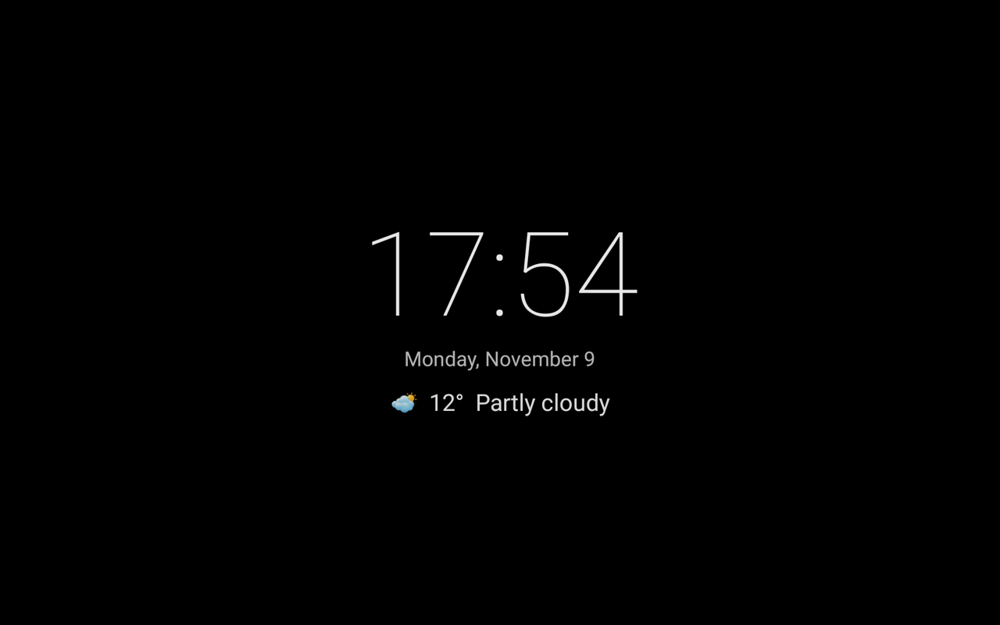

**Wake on motion** (only on tablets with a front camera, off by default): the front camera watches the room at very low
resolution (about 2 frames per second) and treats someone passing in front of the tablet like a touch, so the screen doesn't dim,
or wakes up if it already has. Frames are compared in memory and thrown away; nothing is saved or sent. Android asks for the camera
permission when you turn it on.

### Header sensors

Sensors don't take tile space: temperature, humidity, motion, presence, doors, windows, water leaks, smoke and carbon monoxide detectors and locks are summarised as
**chips under the room name**. Chips turn orange when something needs attention (door open, motion, leak, unlocked). The chips for lights, doors and windows only appear when something is on or open.
Tap any chip to see the individual devices.


### Themes and wallpapers

The background is **a theme or a wallpaper, one or the other**: choosing one turns the other off, and the settings show a single
*Background* choice (Theme / Wallpaper) with the matching list underneath.

- A **wallpaper** is one of 5 gradients (Night, Dawn, Ocean, Forest, Graphite) or **your own photo**. Send the photo from the web
  page (*Appearance → Background → Choose a photo*, JPEG, PNG or WebP up to 25 MB) or pick a file on the tablet itself
  (*Display → Background → My photo*). It is reduced to the screen size, kept only on the tablet, and covered with a veil that
  depends on the skin so the text stays readable (dark for most skins, light paper for Paper). Pastel and Neon take their
  colour from the photo. A photo taken sideways by a phone is straightened. Demo mode never shows your photo.
- A **theme** is one of 18 that add a gradient, a few discreet decorations and a matching greeting. Coming back from a wallpaper
  to *Theme* brings back the last theme used, or the season's.

- **Automatic theme**: pick *Automatic (season and holidays)* and the theme follows the date by itself — a holiday when its day
  comes (Christmas from December 1 to 26, Halloween from October 25 to 31, Easter from Good Friday to Easter Monday, Thanksgiving
  weekend…), otherwise the season. Tick the holidays you follow on the web page; the default list depends on the tablet's country.
  Lunar New Year and Hanukkah move every year and are picked by hand. If a Home Assistant automation also sets the theme, it will
  replace *Automatic*: use one or the other.
- **Immich photo of the day** as the wallpaper: a new photo from the album of the photo frame every day (*Another photo* on the
  web page for a different one right away). Needs Immich and an album chosen in the screen saver settings.
- **Veil on the photo**: lighter to let the photo stand out, stronger for more readable text (tablet, web page, Home Assistant).

Themes can also be switched by hand (from the tablet, the web page, or a Home Assistant automation):

- **Seasons**: Spring, Summer, Autumn, Winter
- **Holidays**: New Year, Lunar New Year, Valentine's Day, St. Patrick's Day, Easter, Mother's Day, Father's Day,
  Quebec's Fête nationale, Canada Day, Independence Day (US), Thanksgiving, Halloween, Hanukkah, Christmas

| Halloween | Christmas |
|---|---|
| 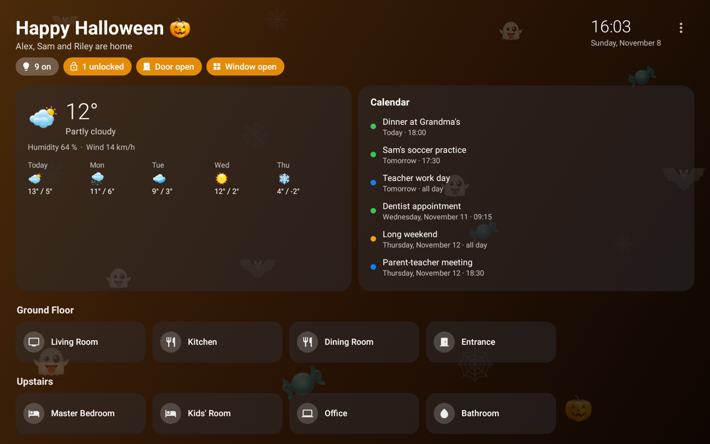 | 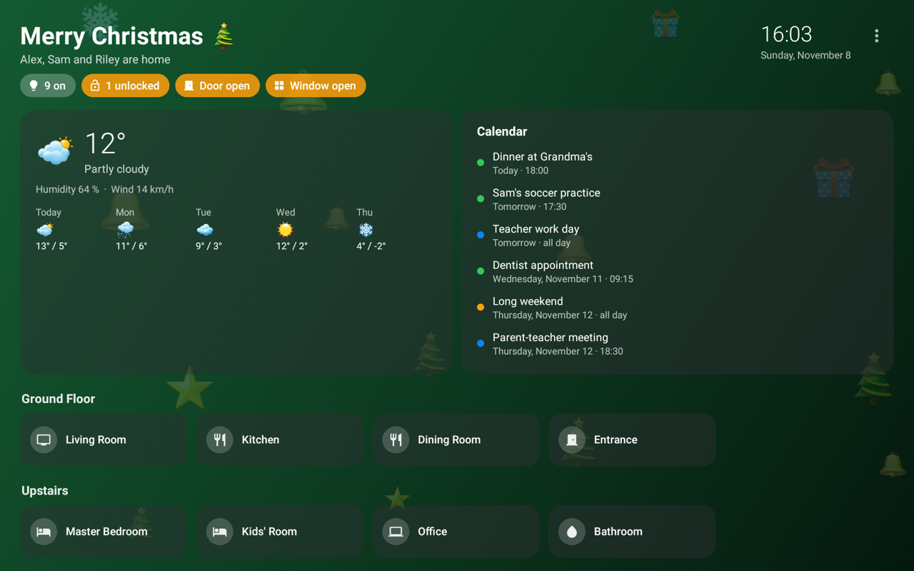 |

Nothing is animated, so themes cost nothing in battery or CPU.

### Skins

A skin changes **how everything is drawn**: tiles, chips, cards, control windows, notifications, timers and *This morning*.
The structure stays the same, and so do the theme and wallpaper you chose. The tablet's settings screens are not affected.

- **HomeKit** (default): glass tiles; a device that is on turns its tile white.
- **Minimal**: no filled tiles, thin lines under each device, light typography; a device that is on gets a coloured icon and
  a dot. Chips are outlined.
- **Paper**: warm, light paper tinted by the theme or wallpaper, bordered white cards, serif titles and clock; a device that is
  on turns butter yellow. Control windows sit on a sheet of paper.
- **Pastel**: large, very rounded cards in soft tones taken from the theme's colour; a device that is on turns pastel with dark
  text. Warning chips use soft orange and red.
- **Neon**: a very dark background, outlined tiles and cards; a device that is on glows in the theme's colour (e.g. orange for
  Halloween or Autumn). Monospaced clock and temperatures, easy to read in the evening.
- **Compact**: the HomeKit look, smaller, with more devices per row (7 instead of 5 on a 10" tablet), for rooms with many devices.
  Long statuses are shortened (a thermostat shows `20.5° → 21°`).
- **Large print**: the HomeKit look with very large, high-contrast text and 3 tiles per row, readable from across the room.
  The header keeps its chips on one row, alerts first; a **+N** chip opens the full list.

Pastel and Neon follow the active theme (or wallpaper): changing it changes their colour.

| Minimal | Paper |
|---|---|
| 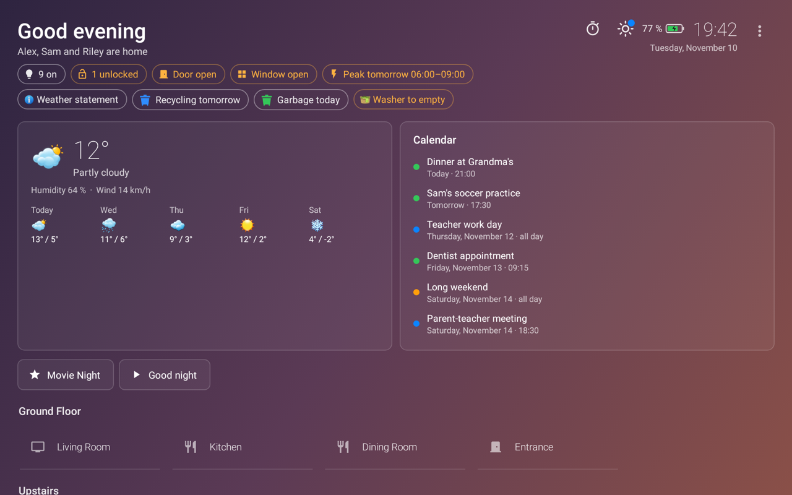 | 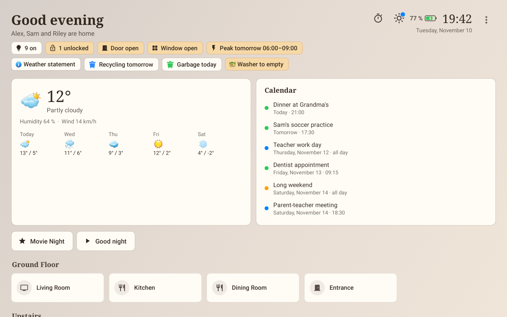 |

| Pastel | Neon |
|---|---|
| 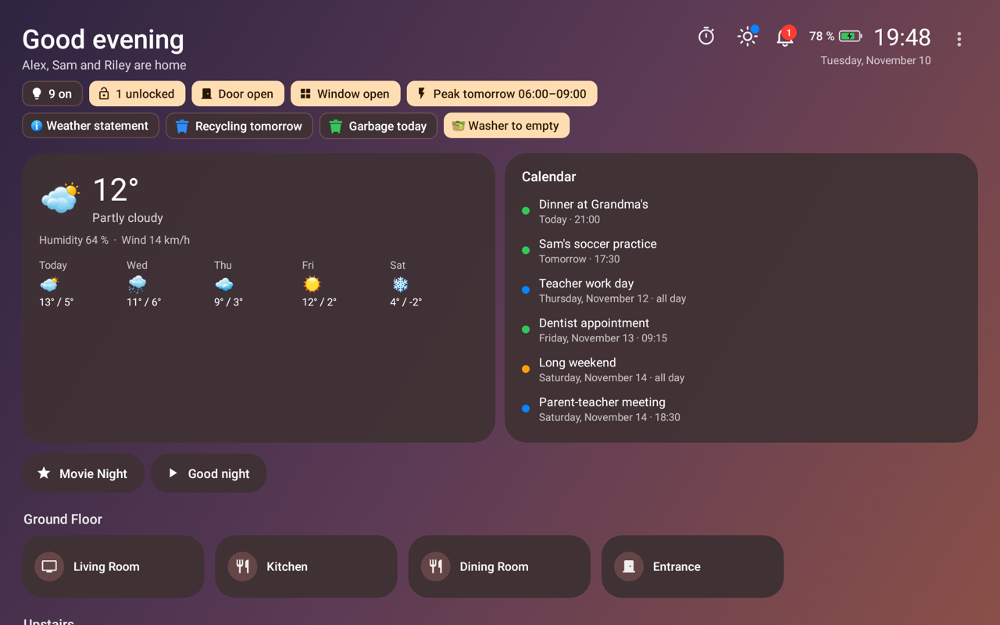 | 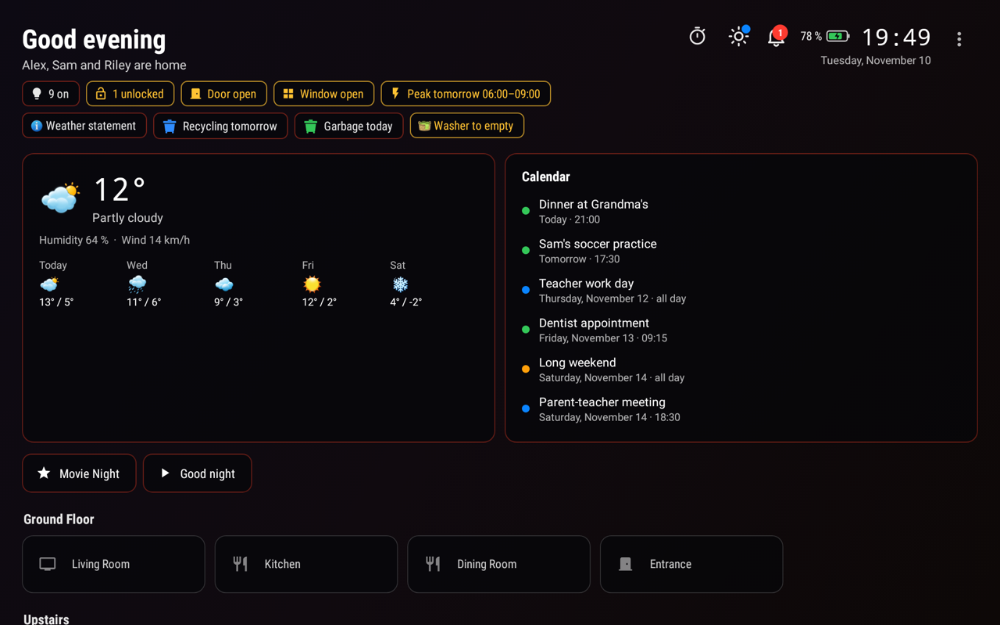 |

| Compact | Large print |
|---|---|
| 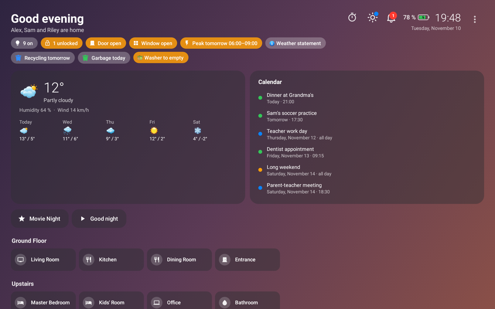 | 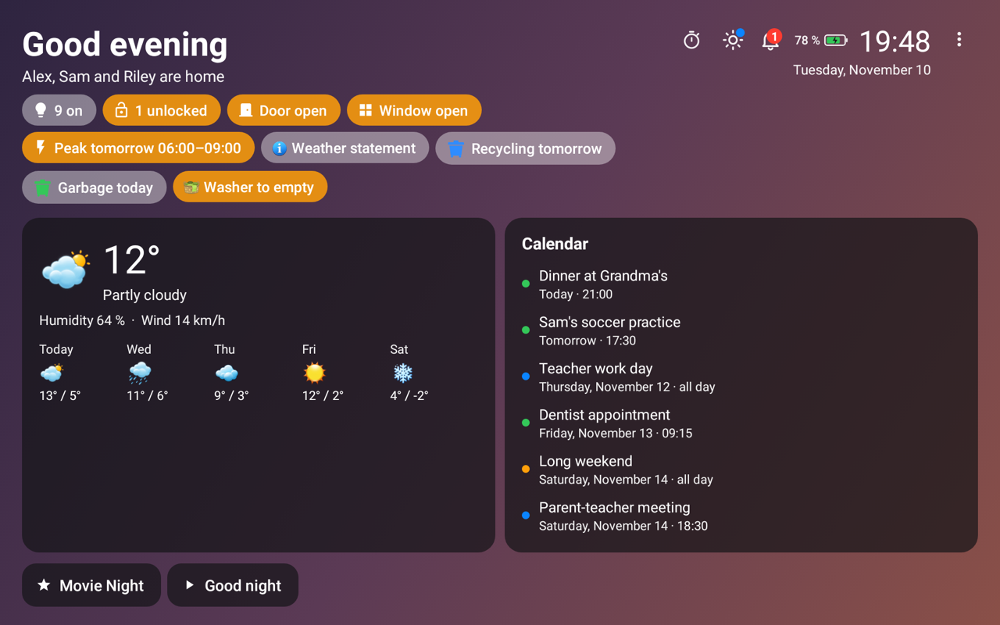 |

Choose it in the tablet's settings (*Display → Appearance*), on the web page (*Appearance*), or with the **Skin** select in
Home Assistant.

**Night skin**: optionally pick a second skin and a time range (default 19:00–07:00), for example Paper by day and Neon in the
evening. The tablet switches by itself at the set times, never while you are touching it or while a window is open. Set it in
the same three places (**Night skin** select in Home Assistant).

### Web configuration page

The tablet runs a small web server (port **8080**). Open the address shown in the settings from any browser on the same network.

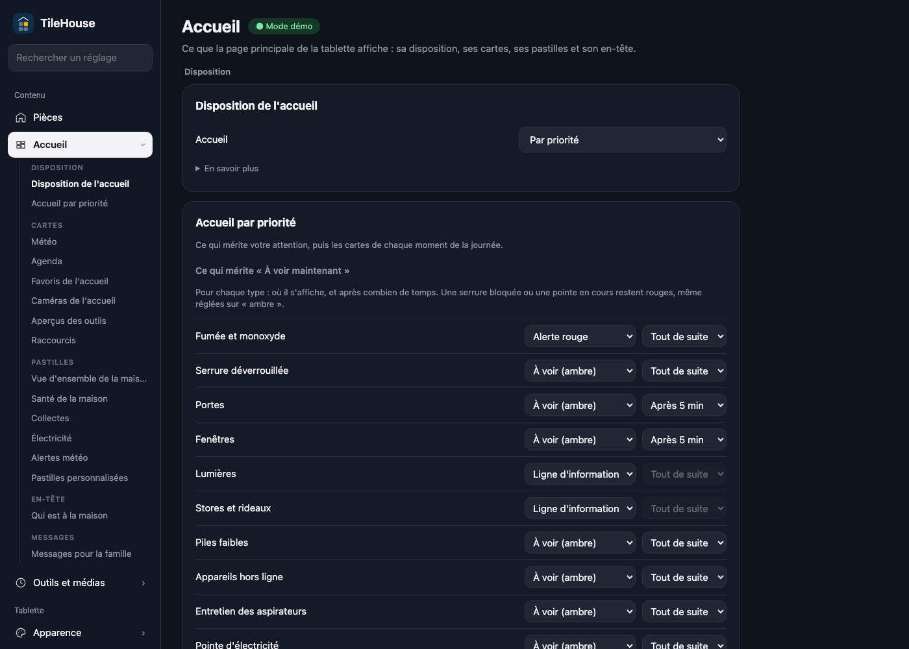

A **menu on the left** lists nine sections in three groups; on a phone it becomes a drop-down list. Each section is a single
column of settings: the name on the left, the value on the right. Choosing several things never uses plain checkboxes:
- **toggle chips** for short lists (calendars, shopping lists, holidays of the automatic theme, *Now playing* players): tap a
  chip to turn it on or off;
- **tokens with a search field** for long lists (people and presence sensors, electricity sensors, weather-alert sensors,
  shortcuts): what you chose is on top, each with a ✕ to remove it, and the field below suggests what you can add. Drag a token
  to change the order — the first electricity sensor makes the home-screen chip, and shortcuts show in that order;
- **switches by room** for the whole-house overview: a filter per kind (lights, locks, doors, windows) with its count, then the
  devices room by room, with *Turn all on / off* per room.

Long explanations sit behind *Learn more*.

| Toggle chips and tokens | Switches by room |
|---|---|
|  | 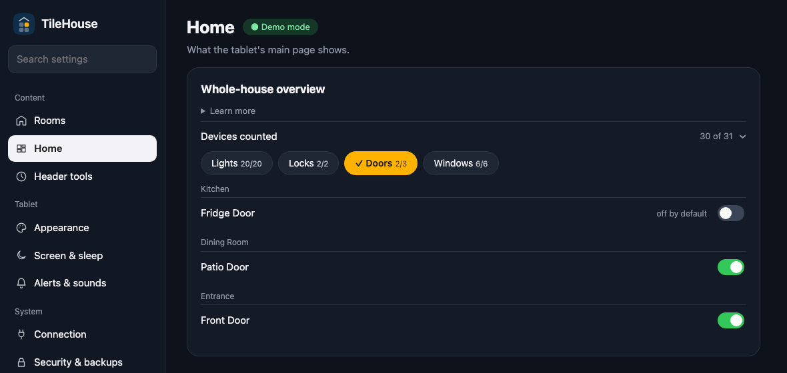 |

| Custom chip: states, icon and colour | This morning: sources and suggestions |
|---|---|
| 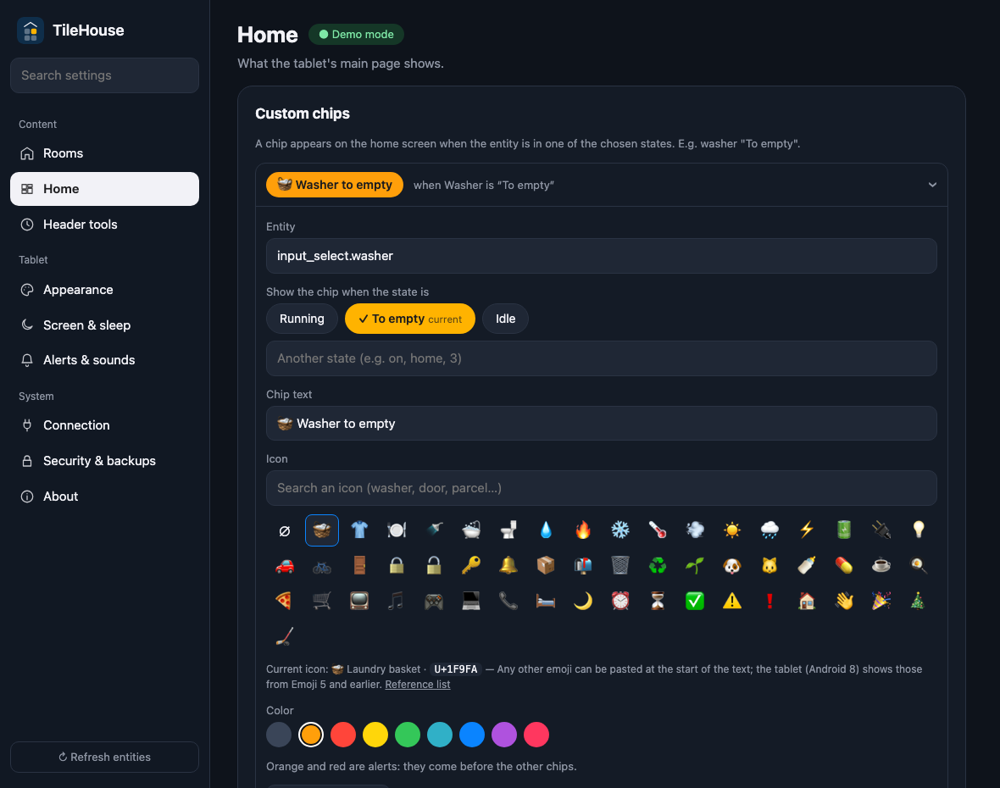 | 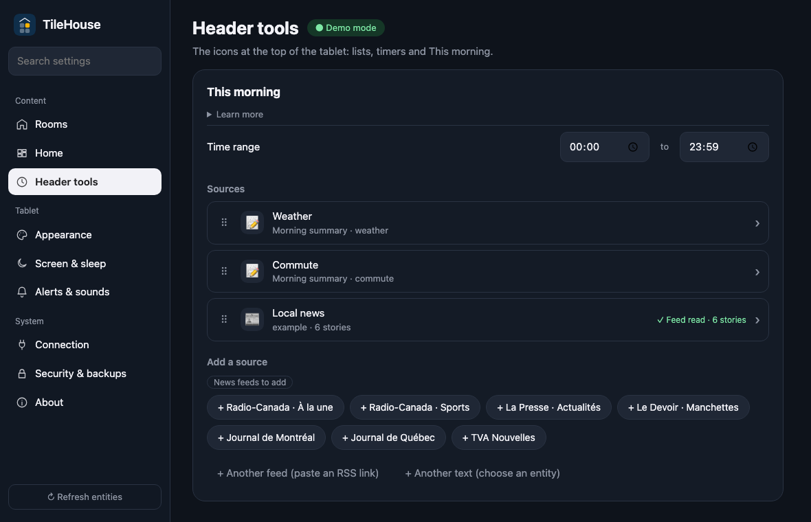 |

| Electricity sensors | Shortcuts and their room |
|---|---|
| 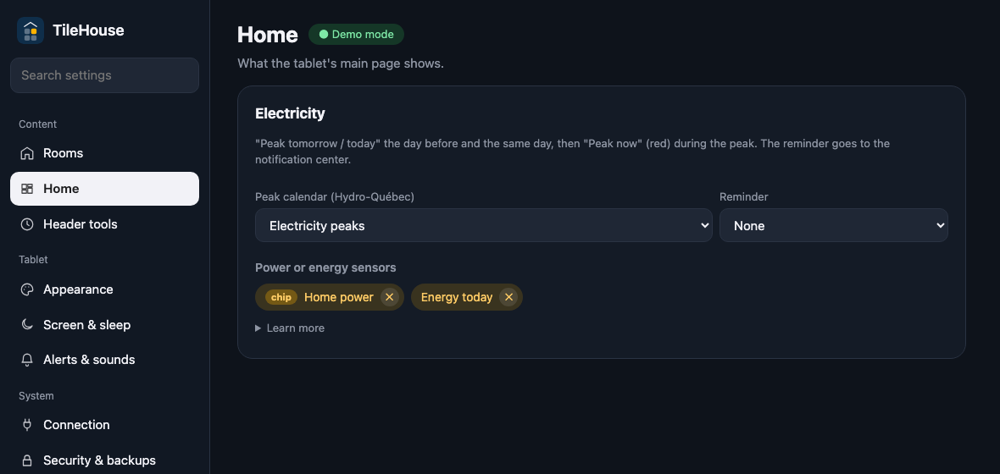 | 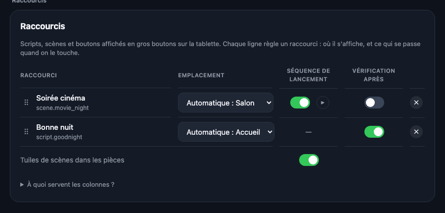 | The **search field** above the menu finds a setting by its name and takes you to it.

**Content**
- **Rooms**: add, rename, delete and reorder rooms (drag ⠿ or ▲▼). For the selected room, search all your Home Assistant devices
  by name, area or type, add them with one click, reorder them, rename them for the tablet, and show hidden/diagnostic entities if needed.
  **Import HA areas** creates rooms from your areas automatically. **Floors** sets the order of the floors the home screen
  groups the rooms by. **Now playing** (the card at the top of a room, the thumbnail in the top bar, the poster search and its optional keys, its
  players and what happens after a pause) is here too.
- **Home**: what the main page shows, top to bottom: **Header** (who's home, whole-house overview), **Cards** (weather, calendar),
  **Messages** (family messages), **Home screen with side navigation** (favourites, tool previews, cameras), **Information chips** (collections, electricity, weather alerts and radar, custom chips) and **Shortcuts** (with the good-night summary). The birthday calendar is chosen in the *Calendar* card.
- **Devices & health**: **Tracked appliances** (3D printer, washer, oven…) and **Home health** (the low-battery, offline and vacuum-maintenance chips).
- **Tools & media**: **Tools** — shopping and to-do lists, favourite timers, This morning and sports — and **Media** — music (the Music Assistant
  speakers offered, and the server token for the queue) and Now playing (posters, TV channels, log, which players count).

**Tablet**
- **Appearance**: language, layout, skin and night skin, the sections shown, dashboard options and the background (theme or wallpaper, your photo).
- **Screen & sleep**: brightness, sleep delay, wake on motion (front camera, or Home Assistant presence sensors), brightness by room
  (the screen dims when the lights of its room are all off), and the screen saver (including the Immich photo frame).
- **Alerts & sounds**: safety first — **Safety alarms** (smoke, carbon monoxide, water leak, and the test), **Locks** (confirm before
  unlocking) and **Camera alerts** — then **Notifications** and **Sounds and quiet hours**.

The room editor shows one clean row per device: drag ⠿ to reorder, and ✎ (rename for the tablet only) and ✕ (remove) appear
when you point at a row — they are always visible on a touch screen. Device types are filter chips, and a device that is
already in another room says so. In *This morning*, each source is a compact row (title, site, number of stories, and whether
the feed answered) that you drag to reorder and open to edit; suggestions are grouped into news feeds and Home Assistant texts.

**System**
- **Connection**: Home Assistant address and token, demo mode, and MQTT.
- **Access & backups**: PIN, export and restore. The tablet also keeps an **automatic copy of the configuration every week**
  (the last six, without the token, the passwords or the PIN); download or restore one, or make one right away.
- **About**: version, GitHub links, tablet and Home Assistant information, and **updates** (check, install, upload an APK).

| Rooms | Devices & health |
|---|---|
| 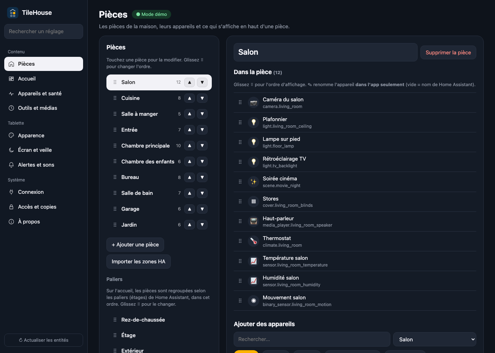 | 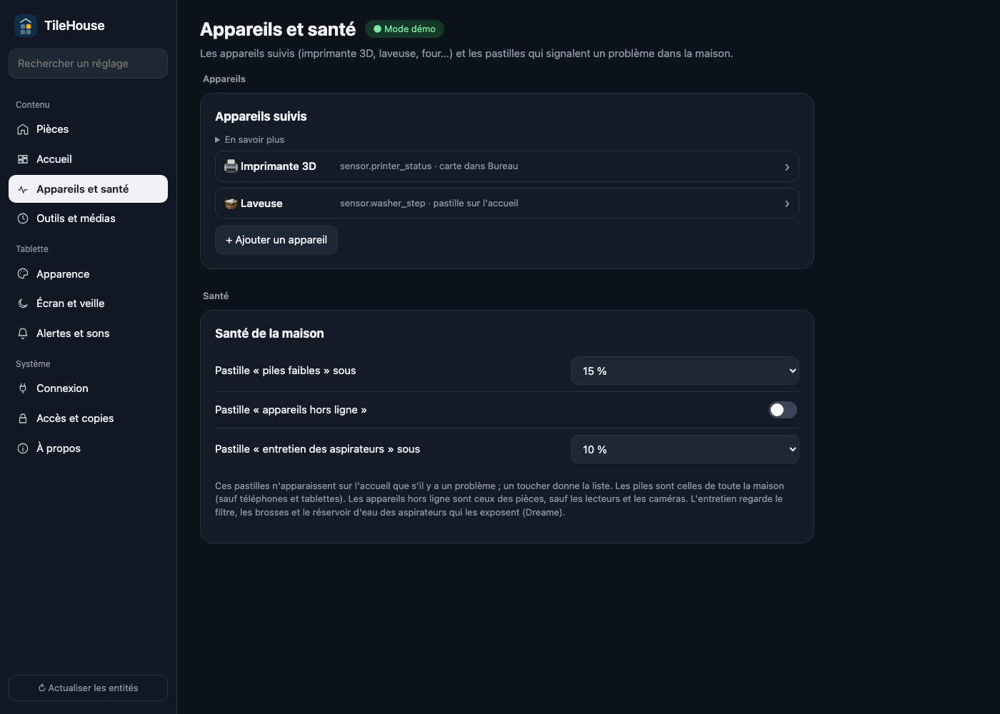 |

| Tools & media | Alerts & sounds |
|---|---|
| 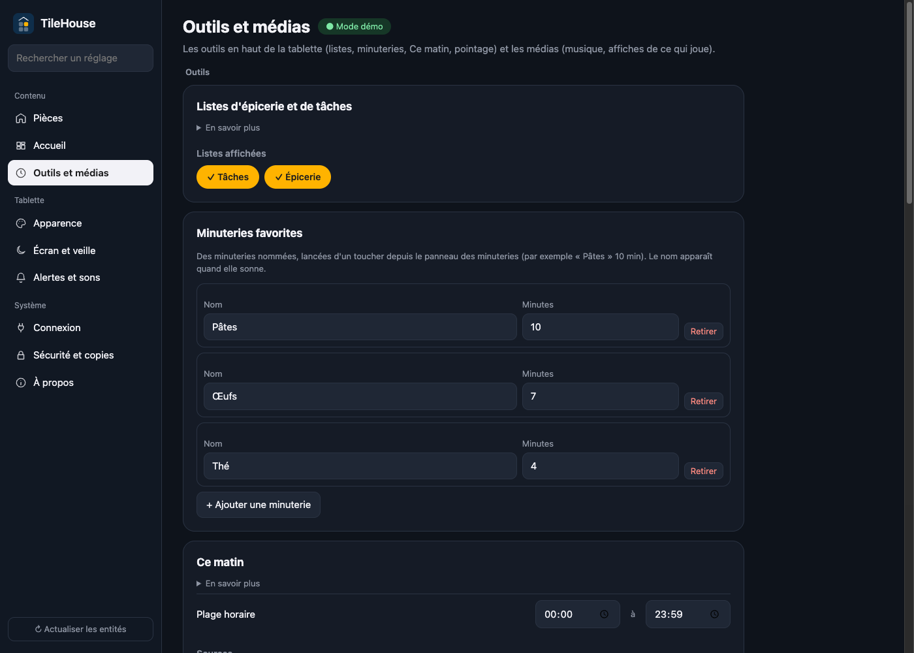 |  |

| Appearance | Screen & sleep |
|---|---|
|  |  |

| Connection | Access & backups |
|---|---|
|  |  |


Changes are applied to the tablet instantly. If the configuration was changed elsewhere in the meantime (on the tablet or in another
browser), the page reloads it instead of overwriting it. Deep links work too: `http://<tablet>:8080/#rooms`, `#home`, `#devices`, `#tools`, `#display`, `#screen`, `#sound`, `#conn`, `#security`, `#about`.

### Tablet settings

The same options are available on the tablet itself (⋮ menu → settings), protected by the PIN if you set one.

The **About** tab shows the version, GitHub links (repository, release notes, issues), the tablet and Android version, the
Home Assistant version and connection, memory use, and the **last crash** if there was one (date, version and error; the web
page shows the full trace and can clear it). After a fatal error the app **reopens by itself** two seconds later, instead
of staying frozen behind Android's "TileHouse has stopped" window (if it crashes again within two minutes, Android's window is
left in place so it doesn't restart in a loop). **Test the crash journal** (web page) causes a real crash on purpose, to check
that it is recorded, that the app comes back and that Home Assistant is told.

**↻ Refresh entities**, at the top of the web page, reads the list of devices, calendars, lists and sensors again from Home
Assistant, for instance right after creating a to-do list. The list is also read again by itself after every reconnection.

Eight tabs, named and grouped like the web page: **Rooms**, **Appearance**, **Home** (sections shown, tool previews), **Screen**
(brightness, sleep, screen saver), **Alerts** (safety alarms and their test, locks, camera alerts, home health, notifications,
sounds and quiet hours), **Connection**, **Access** (web page, PIN, kiosk mode) and **About**. What needs a list of entities
(tracked appliances, wake sensors, the lights of the room, calendars) is set on the web page. A setting that depends on a switch (quiet-hours times, alert trigger and duration)
only shows when that switch is on; on the web page it is greyed out.

| Rooms | Display |
|---|---|
|  |  |

| Alerts | Connection |
|---|---|
|  |  |

| Access | About |
|---|---|
|  |  |

### The tablet as a Home Assistant device (MQTT)

If you use MQTT (for example the **Mosquitto broker** add‑on), TileHouse registers the tablet through **MQTT discovery**. No custom
integration or YAML needed: enter the broker address, user and password in the web page (*Connection → Tablet in Home
Assistant*), and the device appears under *Settings → Devices & services → MQTT*. Its **Visit** link opens the web configuration page.

The entities follow Home Assistant's conventions: what you use every day is shown first, the tablet's settings are under
**Configuration** and technical information under **Diagnostic** on the device page.

| Entity | Type | Use |
|---|---|---|
| **Controls and sensors** | | |
| Screen brightness | number (5–100 %) | |
| Screen asleep | switch | turn the screen off/on (e.g. at night or when nobody is home) |
| Back to home | button | |
| Message | notify | show a notification card in the middle of the screen (`notify.send_message`, see [Notifications](#notifications)) |
| Screen shown | sensor | which screen/room is displayed |
| Unread notifications | sensor | number of unread notifications |
| Theme shown | sensor | the theme on screen (useful with the automatic theme) |
| Running timers, Next timer ends | sensors | how many kitchen timers run, and when the next one ends |
| Timer finished | event | fires when a kitchen timer ends, with its name and duration |
| **Configuration** | | |
| Skin / Night skin | selects | |
| Background / Theme / Wallpaper | selects | Background is *Theme* or *Wallpaper*; picking a theme or a wallpaper switches it. E.g. the Christmas theme on December 1st. An automation that sets the theme can first check that Background is *Theme*, so it does not replace a wallpaper you chose |
| Veil on the wallpaper photo | number (0–100 %) | |
| Group by category, Show clock, Show battery | switches | |
| Dim after | number (min) | |
| Screen saver, Screen saver brightness | select, number | time and weather, photo frame or black screen; its brightness |
| Notification sounds, Quiet hours | switches | all notification sounds on or off; quiet hours on or off (e.g. on holidays) |
| Notification duration | number (s) | how long a notification stays on screen |
| TileHouse | update | installed / latest version, **Install** button |
| **Diagnostic** | | |
| Battery | sensor (%) | e.g. smart charging: turn a smart plug on below 30 %, off above 80 % |
| Charging | binary sensor | |
| Power source | sensor (AC / USB / wireless / unplugged) | |
| Battery temperature, Wi‑Fi signal, IP address, Memory used (MB) | sensors | |
| Last start, Last crash | sensors (date and time) | when the app last started; when it last closed on an error (with a short summary), to notice a problem on a tablet nobody watches |

The device stays the same even if you reinstall the app or move your configuration to another tablet (its ID is kept in backups).

### Demo mode

Turn on **Demo mode** (tablet: *Settings → Connection*; web page: *Connection*), or tap **Try the demo** on the welcome
screen. TileHouse then shows a fictional house with 10 rooms, about 70 devices, cameras, weather, calendars and people. Everything
reacts to touch, but nothing leaves the tablet. Your own configuration is kept aside and comes back as soon as you leave the demo
(or save a real Home Assistant connection).

### Backup and restore

In the web page (*Security & backups → Backup*), **Export configuration** downloads a JSON file with your rooms, devices, custom names,
order, home screen and display settings. Secrets are excluded unless you tick the box. **Restore a backup…** applies such a file:
handy after a reinstall or to set up a second tablet.

### Languages

The interface, the web page and the MQTT entity names are available in **English** and **French**. By default TileHouse follows the
tablet's language; you can force one in *Display → Language*.

---

## Updating over Wi‑Fi

TileHouse checks GitHub for a new release **every 6 hours**. There are three ways to install it:

1. **From Home Assistant**: the **TileHouse** update entity shows the new version. Click **Install**.
2. **From the tablet**: *Settings → About → Updates → Install*.
3. **From the web page**: *About → Update*. Use **Check for updates** / **Install**, or **Upload an APK…** to send an
   APK file directly from your computer (useful for test builds or without internet access).

Android always asks for a **confirmation on the tablet** (one tap on *Install*). The very first time, Android also asks you to allow
TileHouse to install apps: turn on **Allow from this source**, go back, and start the update again.

**Google Play Protect** may also step in, because TileHouse is not distributed through the Play Store. Choose **Scan app**: the APK is
checked by Google and the installation continues. Depending on the Play Protect version, *More details → Install anyway* may also be offered.
TileHouse reopens by itself once the update is installed.

> **"Harmful app blocked"?** Play Protect is wary of new apps that are not on the Play Store and that can install updates
> themselves, so it may block over‑the‑air updates even when installing the same APK by hand works. Two fixes:
> - install the new APK by hand once (download it from the releases page in the tablet's browser and open it), or
> - on a dedicated wall tablet, turn off scanning: *Play Store → profile picture → Play Protect → ⚙️ → Scan apps with Play Protect*.
>   Wi‑Fi updates then install normally. You can turn it back on at any time.

> Updates must be signed with the same key as the installed app. Official releases are all signed with the same release key, so
> they always install over each other. If you build the app yourself with a different key, uninstall the official app first
> (export your configuration before).

---

## When Home Assistant is unreachable

- A red **"Offline · retrying…"** banner appears and the tiles are greyed out: they show the last known state, which may be out of date.
- Tapping a device shows "Home Assistant is not responding" instead of silently doing nothing; nothing is queued, so a command
  is never sent late by surprise.
- TileHouse reconnects by itself (after 2 s, then up to every 30 s); a dead connection is detected within about 25 s. Back on
  line, the states are refreshed and the MQTT device comes back a few seconds later.
- Timers, the clock, the screen saver (except weather) and the web page keep working; camera live views, alerts and
  notifications need Home Assistant.

## Security and privacy

- TileHouse talks to your Home Assistant, your MQTT broker and GitHub (to check for updates), plus the services you turn on
  yourself: your Immich server (photo frame), the feeds you add to This morning, and for music your Music Assistant server and
  the servers that host the covers (usually your music service), and for posters and artist photos TVmaze, iTunes, Deezer, YouTube (search page and image server), ESPN (team lists and logos), GitHub (channel logos) and,
  with your keys, TMDB and the YouTube Data API. No analytics, no accounts.
- The Home Assistant token, the MQTT password, the PIN, the Immich key, the Music Assistant token and the TMDB and YouTube keys are **encrypted at rest** with a key kept in the Android Keystore.
  They are never displayed again once saved, and never included in a backup unless you ask for it.
- **Wake on motion** is off by default. When you turn it on, the front camera's frames are compared in memory at very low resolution
  and thrown away: nothing is recorded, saved or sent.
- The web page requires the **PIN** when one is set (5 wrong attempts lock it for a while). Use a PIN on any shared network.
- The web page only accepts JSON requests from itself (basic CSRF protection) and can only be embedded in a frame by Home Assistant.
- Traffic to Home Assistant uses whatever you configure: use `https://` if your instance supports it.

---

## Performance

TileHouse was written for old tablets with little memory:

- Native Android views only (no WebView, no Jetpack Compose, no AppCompat); about **35–60 MB** of RAM in use.
- Home Assistant's `subscribe_entities` with a filter: the tablet only receives the entities it displays, in compressed form.
- Large responses are parsed in a streaming way and trimmed; the full device list is only loaded while you edit rooms.
- Snapshots are decoded at screen size in RGB_565, and only refreshed while visible.
- The video player is only loaded when you open a live view, and released when you close it.

---

## Building from source

Requirements: JDK 17 and the Android SDK (platform 36).

```bash
git clone https://github.com/gharl77/TileHouse.git
cd TileHouse
./gradlew assembleRelease          # signed with the debug key
adb install -r app/build/outputs/apk/release/app-release.apk
```

To sign with your own release key, create `keystore.properties` at the project root (it is git‑ignored):

```properties
storeFile=keystore/release.jks
storePassword=…
keyAlias=…
keyPassword=…
```

then build with `./gradlew assembleRelease -Pdistribution`.

The version is set in [`app/build.gradle.kts`](app/build.gradle.kts) (`appVersion`); the version code is derived from it.

**Tests**: `./gradlew testReleaseUnitTest` runs the unit tests on your computer, without a tablet (news-feed parser, notification
parsing, time ranges, translations, and a readability check of every skin). GitHub runs them and builds the app on every push
([`.github/workflows/build.yml`](.github/workflows/build.yml)).

**Code layout**: `MainActivity.kt` holds the dashboard's state, life cycle, navigation and sleep; its features live next to it in
`MainHome.kt` (home screen), `MainRoom.kt` (a room), `MainChips.kt` (header chips and their windows) and `MainOverlays.kt`
(timers, notifications).

**Adding a skin**: write one `SkinDef` in [`Skin.kt`](app/src/main/java/com/homepanel/kiosk/Skin.kt) (colours, fonts, sizes,
surfaces and the look of a tile, on or off) and add it to the list. The screens only read the current skin, so nothing else changes.

**Testing on a tablet that is in use**: `tools/tablet-snapshot.sh save http://TABLET:8080 file.json` copies its configuration
(without secrets) before you switch to demo mode, another language or another skin, and `… restore …` puts it back and checks
the result. Take the copy after installing the version you are testing: a setting added by a newer version is not in an older
copy (the script says so).

---

## Versioning

TileHouse uses **calendar versioning**: `YEAR.MONTH.N`, where `N` is the release number within that month.
`2026.11.1` is the first release of November 2026. See the [changelog](CHANGELOG.md).

---

## License

[MIT](LICENSE) © 2026 gharl77

TileHouse is not affiliated with Home Assistant, Nabu Casa or Apple. "Home Assistant" is a trademark of its respective owner.
