<p align="center">
  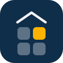
</p>

<h1 align="center">TileHouse</h1>

<p align="center">
  <b>A lightweight, HomeKit‑style Home Assistant dashboard for wall‑mounted Android tablets.</b><br>
  Native Android app · No WebView · Runs smoothly on old 2 GB tablets
</p>

<p align="center">
  <a href="https://github.com/gharl77/TileHouse/releases/latest"></a>
  
  
</p>

<p align="center">
  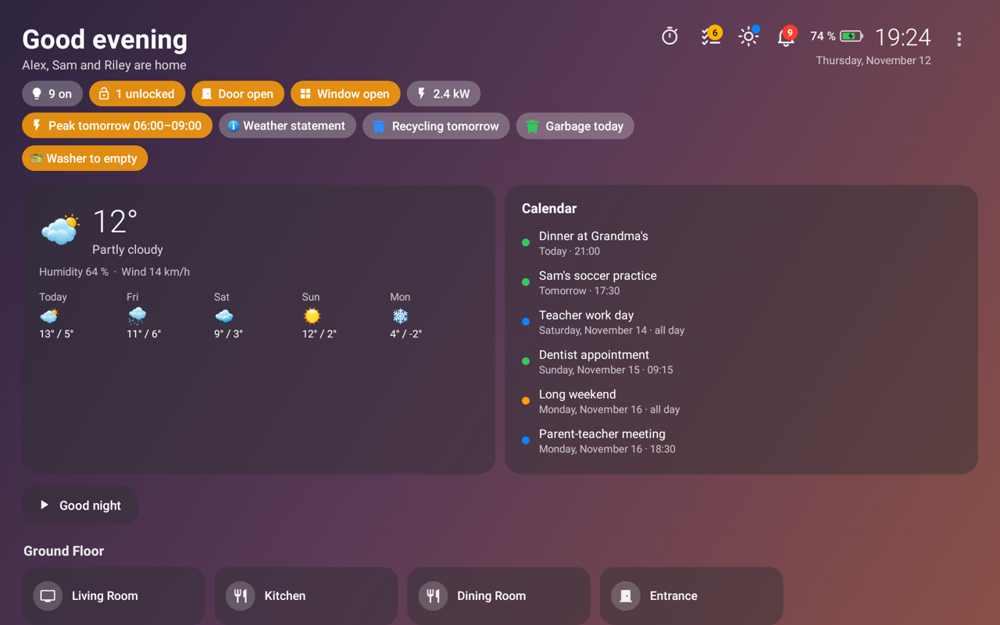
</p>

TileHouse turns an Android tablet into a kiosk panel for [Home Assistant](https://www.home-assistant.io/).
You build the dashboard **inside the app**: pick your rooms and devices, rename them for the tablet only, and get a clean, touch‑friendly
interface inspired by Apple Home. It is not a Lovelace dashboard in a browser: it is a native app written to stay fast and
memory‑light on aging hardware (developed on a Samsung Galaxy Tab A 10.1, SM‑T580, Android 8.1, 2 GB RAM).

> All screenshots on this page come from TileHouse's built‑in **demo mode**: a fictional house with invented devices.

---

## Contents

- [Highlights](#highlights)
- [Installation](#installation)
- [First setup](#first-setup)
- [Features in detail](#features-in-detail)
  - [Home screen](#home-screen)
  - [Rooms](#rooms)
  - [Detailed controls](#detailed-controls)
  - [Cameras](#cameras)
  - [Header sensors](#header-sensors)
  - [Themes and wallpapers](#themes-and-wallpapers)
  - [Web configuration page](#web-configuration-page)
  - [Tablet settings](#tablet-settings)
  - [The tablet as a Home Assistant device (MQTT)](#the-tablet-as-a-home-assistant-device-mqtt)
  - [Demo mode](#demo-mode)
  - [Backup and restore](#backup-and-restore)
  - [Languages](#languages)
- [Updating over Wi‑Fi](#updating-over-wifi)
- [Security and privacy](#security-and-privacy)
- [Performance](#performance)
- [Building from source](#building-from-source)
- [Versioning](#versioning)
- [License](#license)

---

## Highlights

- **HomeKit‑style tiles** for lights, switches, plugs, fans, covers, locks, thermostats, media players, scenes, scripts, buttons and sensors.
- **Home screen** with greeting, weather and 5‑day forecast, calendar, who's home, and rooms grouped by Home Assistant floors.
- **Cameras** with periodic snapshots and a full‑screen **live view** (HLS or RTSP), including **PTZ by swiping**.
- **Camera alerts**: the live view pops up when a camera sees a person or when someone rings the doorbell.
- **Notifications from Home Assistant** in a card in the middle of the screen, with title, icon, colour and camera snapshot, and a
  **notification center** (bell with an unread counter) for the ones nobody confirmed.
- **Screen saver** with the time and weather (or a black screen), and optional **wake on motion** with the tablet's front camera.
- **Robot vacuums**: state, battery, start / pause / stop / return to base.
- **Header chips** summarising temperature, humidity, motion, doors, windows, leaks and locks, tap for the details and quick actions.
- **Web configuration page** served by the tablet itself: set everything up comfortably from a computer or phone.
- **MQTT discovery**: the tablet shows up in Home Assistant as a device (battery, charging, screen, brightness, theme, notifications, updates…).
- **18 themes** for seasons and holidays, plus 5 wallpapers.
- **Updates over Wi‑Fi** from GitHub releases, from Home Assistant, or by uploading an APK.
- **English and French**, automatic by default.
- **Demo mode** to try everything without Home Assistant.
- Secrets (HA token, MQTT password, PIN) **encrypted with the Android Keystore**.

---

## Installation

### What you need

| | |
|---|---|
| Tablet | Android **8.0 or newer** (API 26+). Tested on Android 8.1. |
| Home Assistant | Any recent version reachable on your network. |
| Optional | An MQTT broker (e.g. the Mosquitto add‑on) to expose the tablet in Home Assistant. |

### 1. Download the APK

On the tablet, open the [latest release](https://github.com/gharl77/TileHouse/releases/latest) in the browser and download
`TileHouse-<version>.apk`. (You can also download it on a computer and copy it to the tablet over USB.)

### 2. Allow the installation

Android blocks apps that don't come from the Play Store by default. When you open the APK, Android shows a prompt:

1. Tap **Settings** in the prompt.
2. Turn on **Allow from this source** for the app you used to open the APK (your browser or file manager).
3. Go back and tap **Install**.

> On Samsung tablets the setting lives under *Settings → Biometrics and security → Install unknown apps*.

### 3. Open TileHouse

The first screen offers two choices: **Open settings** to connect your Home Assistant, or **Try the demo** to explore with a fictional house.

### 4. Make it a kiosk (recommended)

In TileHouse: *Settings → Kiosk → Set as home app*, choose **TileHouse** and **Always**.
TileHouse now starts with the tablet, and the Home button always brings you back to it.

Other useful Android settings for a wall tablet:

- *Display → Screen timeout*: set it to the maximum. TileHouse keeps the screen on and dims it itself after the delay you choose.
- *Developer options → Stay awake* (while charging), if the tablet is always plugged in.
- Battery optimisation: exclude TileHouse so Android never stops it.

### Install from a computer (optional)

With [ADB](https://developer.android.com/tools/adb) and USB debugging enabled:

```bash
adb install TileHouse-2026.11.2.apk
```

---

## First setup

1. **Create a long‑lived access token** in Home Assistant: click your profile (bottom left) → **Security** tab →
   **Long‑lived access tokens** → **Create token**. Copy it.
2. **Connect the tablet.** The easiest way is the **web configuration page**: TileHouse shows its address on the welcome screen
   (for example `http://192.168.1.42:8080`). Open it from a computer on the same Wi‑Fi, go to **Connection & security**,
   enter your Home Assistant address (for example `http://homeassistant.local:8123`) and paste the token.
3. **Add rooms.** Click **Import HA areas** to create one room per Home Assistant area with its main devices, or **+ Add a room** to build
   them by hand. Then pick devices from the list on the right.
4. **Set up the home screen** (weather, calendars, people, floor order) in the **Home** tab.
5. **Set a PIN** in **Connection & security** so nobody else on your network can change the configuration.

Everything can also be done directly on the tablet, from the ⋮ menu in the top‑right corner.

---

## Features in detail

### Home screen


- **Greeting** that follows the time of day (or the active holiday theme), with **who's home** underneath.
- **Weather card**: current condition, temperature, humidity and wind, plus a **5‑day forecast**
  (any `weather.*` entity, via `weather.get_forecasts`).
- **Calendar card**: upcoming events from the calendars you choose (today and the next few days), colour‑coded by calendar.
- **Header summary** for the whole house, showing only what needs attention: lights on, unlocked locks, open doors, open windows
  (nothing at all when everything is off, locked and closed). Tap a chip to see which devices, with a **Turn off** / **Lock** button
  on each one that can be controlled.
- **Rooms by floor**: rooms are grouped using your Home Assistant floors, in the order you choose. Rooms without a floor appear under *Other rooms*.
- **Clock and date** (optional) in the top‑right corner, with the **tablet's battery** next to the time (optional; green with a bolt
  while charging, red under 20 %).
- After 3 minutes in a room, the tablet returns to the home screen by itself.

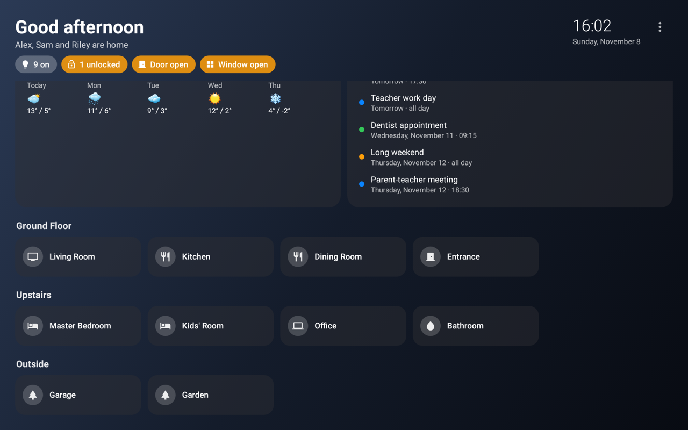

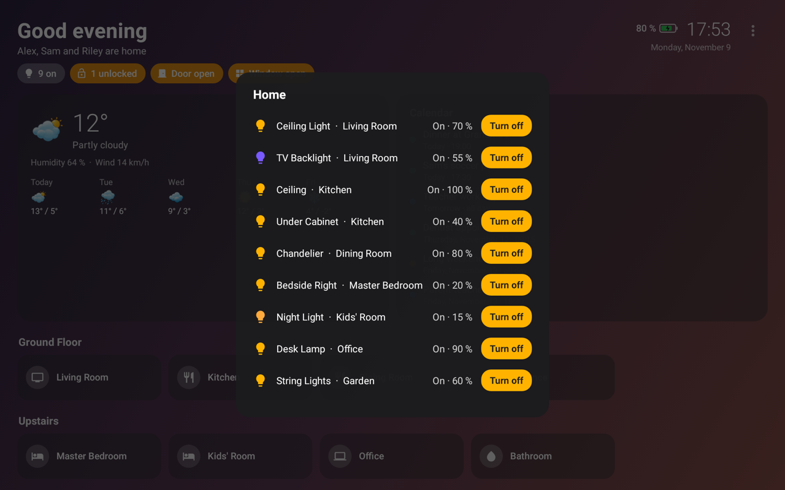

**Who's home** accepts several kinds of entities, so it works with any presence setup:

| Entity | Counts as "home" when… |
|---|---|
| `person.*` (companion app) / `device_tracker.*` | state is `home` |
| `binary_sensor.*`, `input_boolean.*` | state is `on` |
| Room‑presence sensors (ESPresense, Bermuda…), e.g. `sensor.riley_presence` | state is anything but an absence (`not_home`, `away`, `unknown`…) |

### Rooms

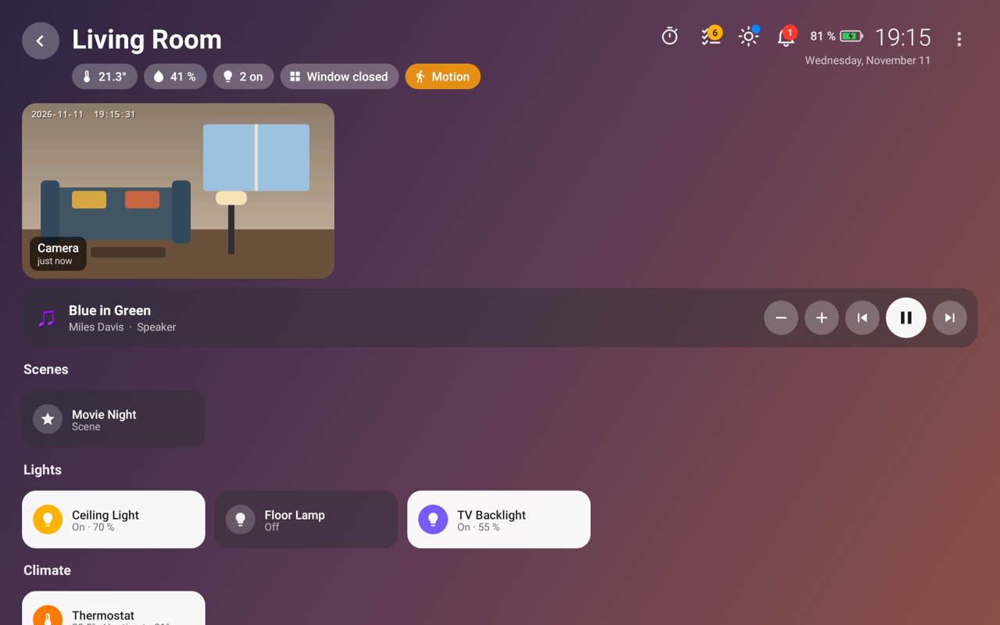

- Tap a room on the home screen to open it; the **←** arrow brings you back. **Swipe left/right** to move between rooms.
- Devices are shown as tiles, **grouped by category** (Cameras, Scenes, Lights, Climate, Blinds & shades, Media, Plugs & switches,
  Security, Sensors…), or in your own order if you turn grouping off.
- **Tap** a tile to toggle it (light, switch, cover, lock, scene, media play/pause…). Active tiles turn white with a coloured icon,
  just like Apple Home; coloured lights use their real colour.
- **Long‑press** a tile for detailed controls.
- Long names wrap onto two lines instead of being cut.
- Names are shortened automatically: *Living Room Ceiling Light* becomes *Ceiling Light* inside the Living Room. You can also give any
  device a custom name **for the tablet only** (Home Assistant is never modified).

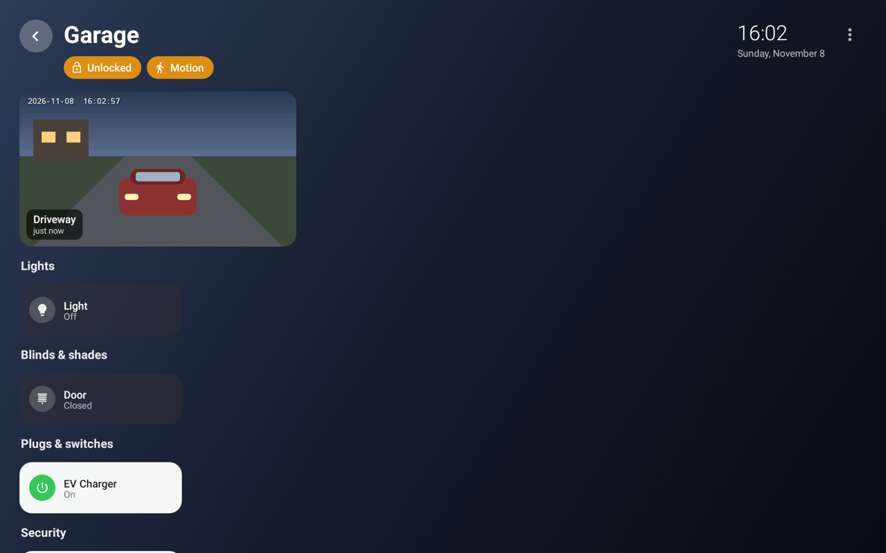

### Detailed controls

Long‑press a tile to open its control panel:

| Light: brightness slider | Thermostat: target and mode |
|---|---|
| 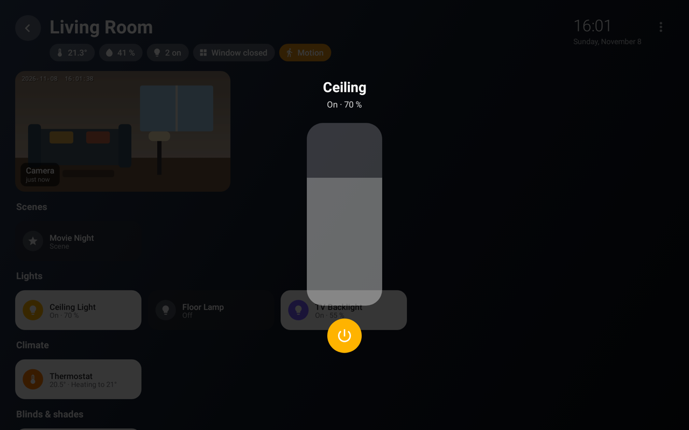 | 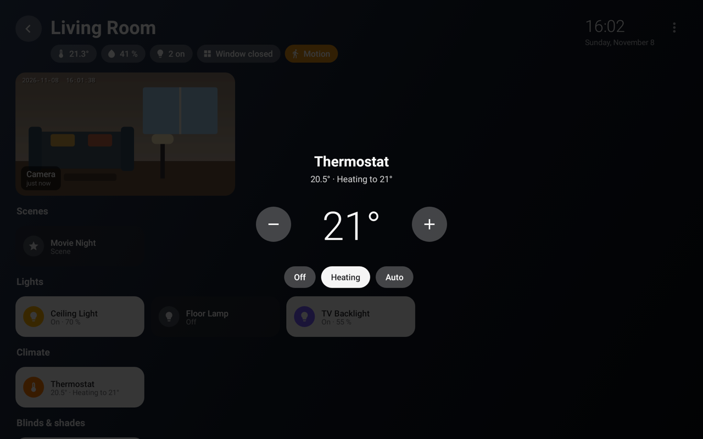 |

- **Lights**: large vertical brightness slider and power button.
- **Fans**: speed slider. **Covers**: position slider plus open / stop / close.
- **Thermostats**: − / + buttons (step taken from the entity), current temperature and action, and HVAC mode pills.
- **Media players**: volume slider, previous / play‑pause / next and power.
- **Robot vacuums**: the tile shows the state and battery; tap it for Start / Resume, Pause, Stop and Return to base.

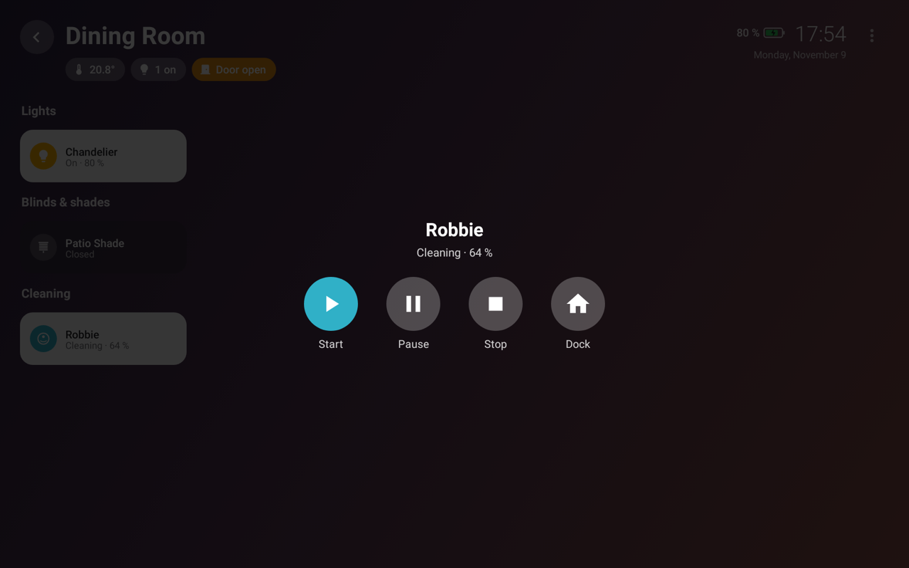

### Cameras

- Every camera in a room shows its **latest snapshot**, refreshed every minute while visible.
- Battery cameras that can't produce a snapshot on demand (some Eufy models, for example) fall back to the camera's latest event image
  from Home Assistant.
- **Tap a camera** for a full‑screen **live view**. TileHouse tries the camera's own **RTSP** stream first when the integration
  publishes one, then Home Assistant's **HLS** stream. Hardware decoding is used; 1080p streams are recommended on older tablets.
- **PTZ cameras**: **swipe** on the live view to pan or tilt. TileHouse finds the camera's PTZ buttons
  (e.g. `button.<camera>_pan_left`) or uses the **ONVIF** `onvif.ptz` service.
- The live view closes itself after 5 minutes so a stream is never left running.
- **Eufy**: when a camera's `switch.<camera>_rtsp_stream` is off, TileHouse turns it on for the live view, waits for the stream
  address, and turns it off again afterwards.
- **Person alert** (Display → Cameras): when a room camera detects a person, its live view opens full screen for 20 seconds
  (10–60 s) with a red "Person detected" banner. Detections come from `event.<camera>_detection` entities (`event_type: person`)
  or `binary_sensor` person detectors. Option: *Trigger on person only / any motion*. The countdown starts with the first video
  frame; touching the screen keeps the live view open.
- **Doorbell alert**: when someone rings a doorbell camera (`event.<camera>_doorbell` ring, or `binary_sensor.<camera>_ringing`),
  its live view opens with a "Someone is at the door" banner.

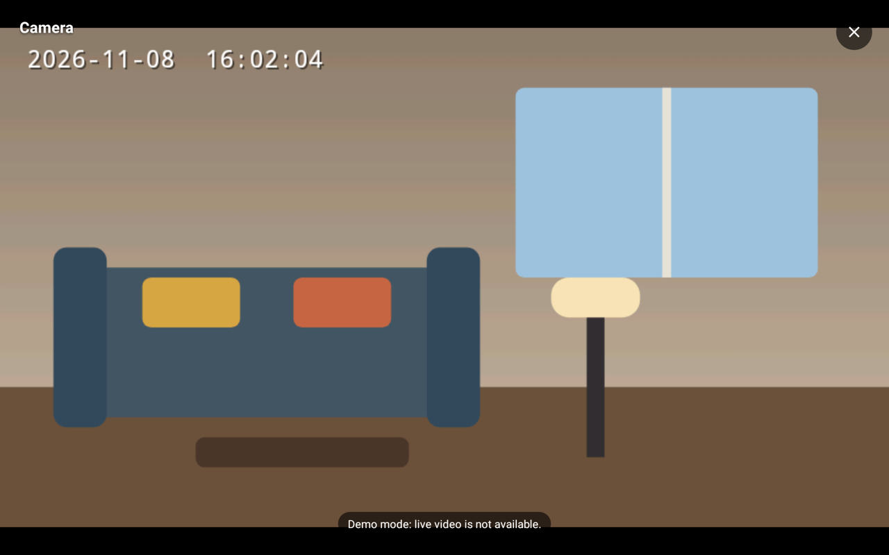

### Header sensors

Sensors don't take tile space: temperature, humidity, motion, presence, doors, windows, water leaks and locks are summarised as
**chips under the room name**. Chips turn orange when something needs attention (door open, motion, leak, unlocked).
Tap any chip to see the individual devices.


### Themes and wallpapers

Pick one of **5 wallpapers** (Night, Dawn, Ocean, Forest, Graphite) or one of **18 themes** that add a gradient, a few discreet
decorations and a matching greeting. Themes are switched manually (from the tablet, the web page, or a Home Assistant automation):

- **Seasons**: Spring, Summer, Autumn, Winter
- **Holidays**: New Year, Lunar New Year, Valentine's Day, St. Patrick's Day, Easter, Mother's Day, Father's Day,
  Quebec's Fête nationale, Canada Day, Independence Day (US), Thanksgiving, Halloween, Hanukkah, Christmas

| Halloween | Christmas |
|---|---|
| 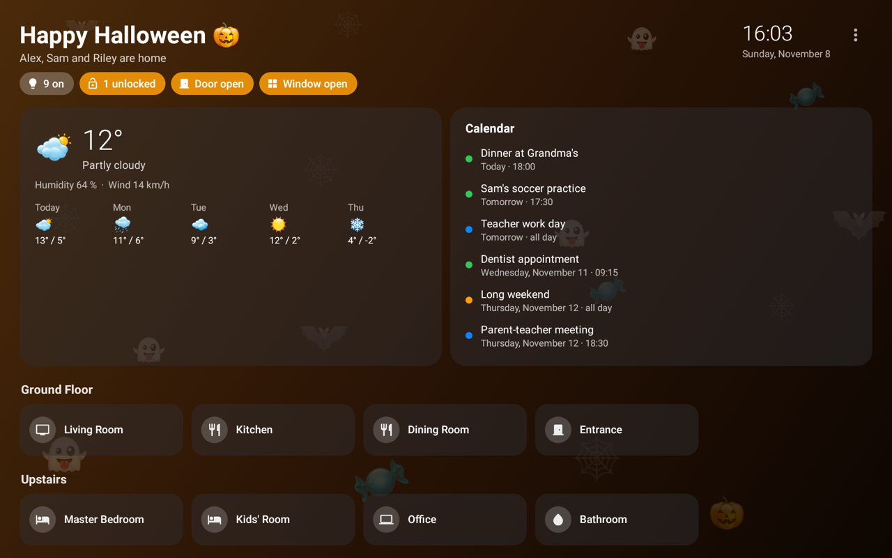 | 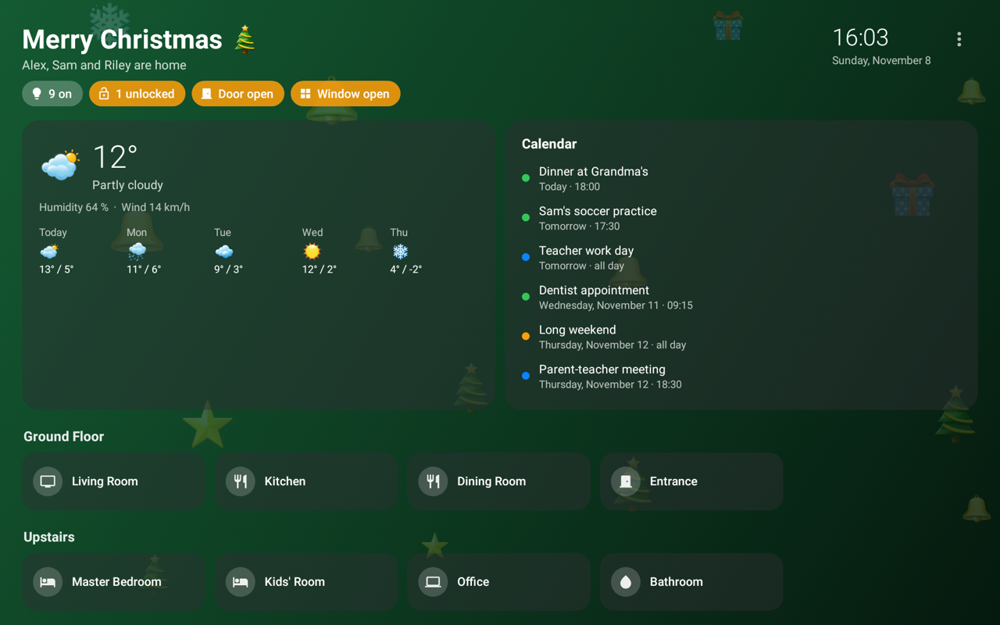 |

Nothing is animated, so themes cost nothing in battery or CPU.

### Web configuration page

The tablet runs a small web server (port **8080**). Open the address shown in the settings from any browser on the same network.

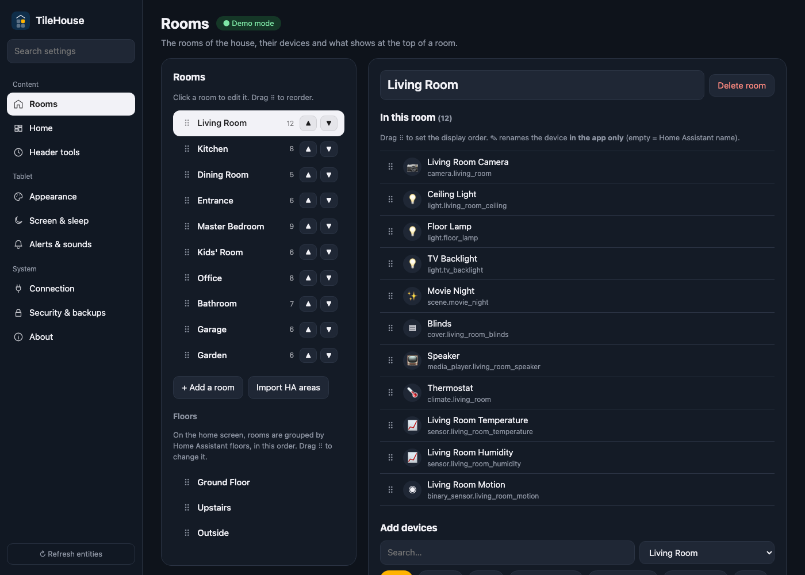

- **Rooms**: add, rename, delete and reorder rooms (drag ⠿ or ▲▼). For the selected room, search all your Home Assistant devices
  by name, area or type, add them with one click, reorder them, rename them for the tablet, and show hidden/diagnostic entities if needed.
  **Import HA areas** creates rooms from your areas automatically.
- **Home**: weather entity, calendars, people and presence sensors, and the **order of floors**.
- **Display**: language, theme, wallpaper, category grouping, clock and battery, screen saver and its brightness, wake on motion,
  and camera alerts.
- **Connection & security**: Home Assistant address and token, demo mode, PIN, backup and restore, and MQTT.
- **About**: version, GitHub links, tablet and Home Assistant information, and **updates** (check, install, upload an APK).
  Hover a device in the room editor to see its full name and ID.

| Home | Connection & security |
|---|---|
| 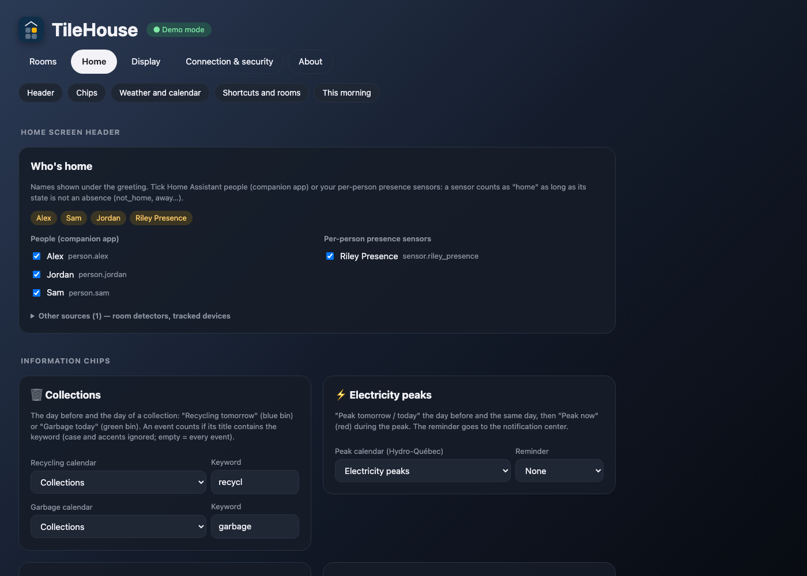 | 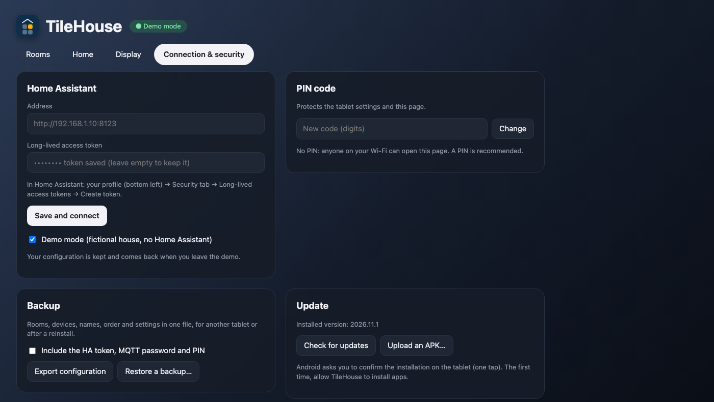 |

| Display | About |
|---|---|
| 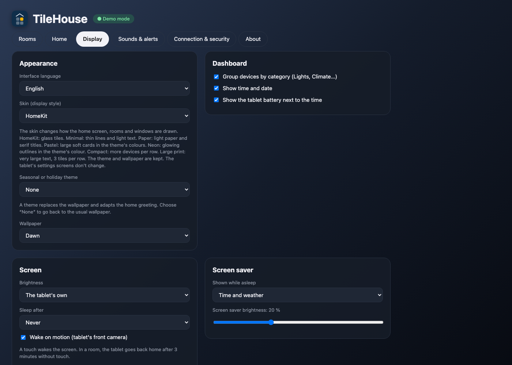 | 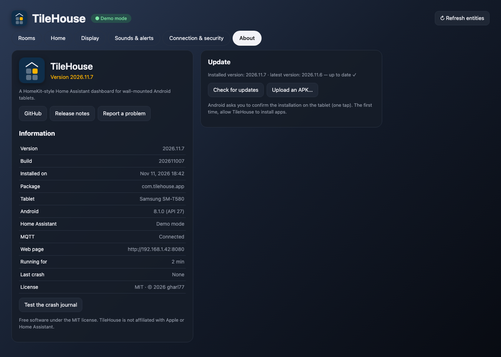 |

Changes are applied to the tablet instantly. If the configuration was changed elsewhere in the meantime (on the tablet or in another
browser), the page reloads it instead of overwriting it. Deep links work too: `http://<tablet>:8080/#home`, `#display`, `#conn`, `#about`.

### Tablet settings

The same options are available on the tablet itself (⋮ menu → settings), protected by the PIN if you set one.

**Screen saver** (Display): after the idle delay the screen shows either the **time, date and current weather** (moving a little
every minute so nothing burns in, at a brightness you choose, 1–60 %) or a **black screen**. A touch wakes it.

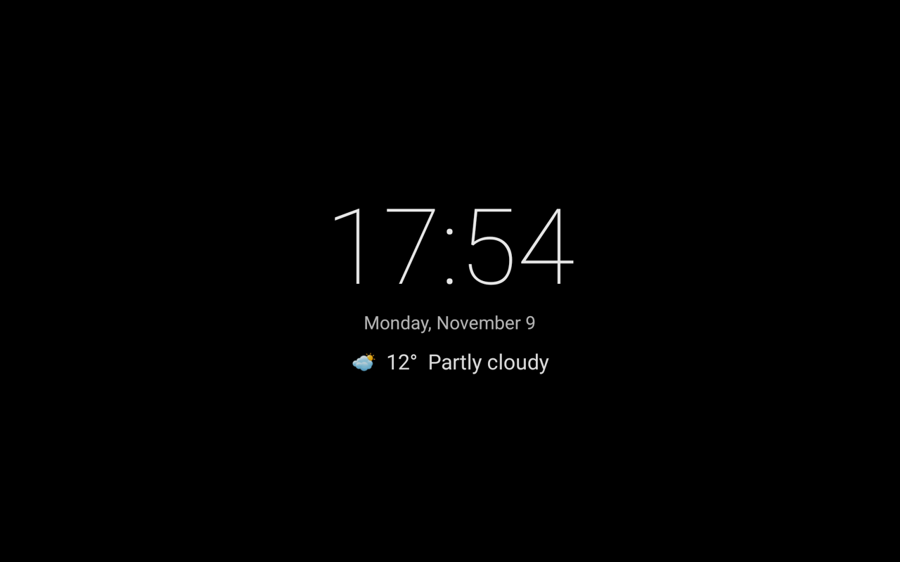

**Wake on motion** (Display, only on tablets with a front camera, off by default): the front camera watches the room at very low
resolution (about 2 frames per second) and treats someone passing in front of the tablet like a touch, so the screen doesn't dim,
or wakes up if it already has. Frames are compared in memory and thrown away; nothing is saved or sent. Android asks for the camera
permission when you turn it on.

The **About** tab shows the version, GitHub links (repository, release notes, issues), the tablet and Android version, the
Home Assistant version and connection, and memory use.

| Rooms | Display |
|---|---|
| 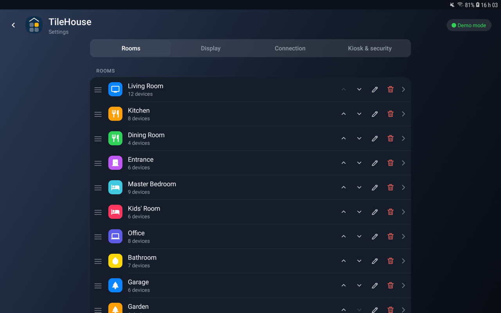 | 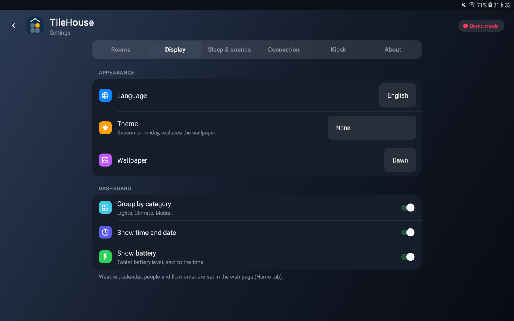 |

| Connection | Kiosk |
|---|---|
| 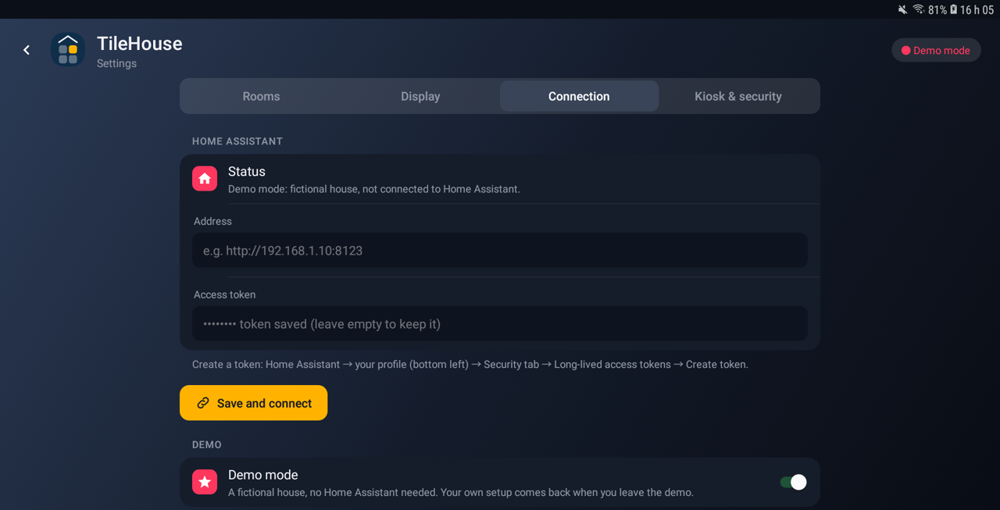 | 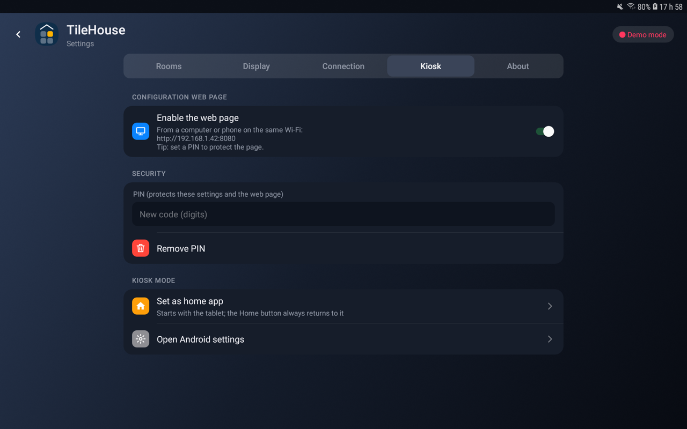 |

| About | |
|---|---|
| 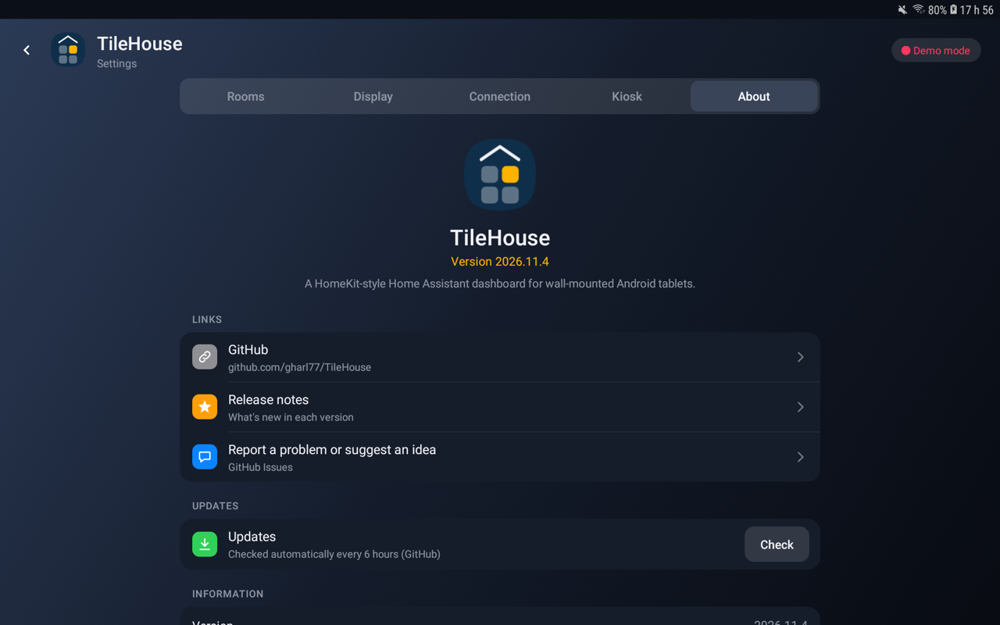 | |

### The tablet as a Home Assistant device (MQTT)

If you use MQTT (for example the **Mosquitto broker** add‑on), TileHouse registers the tablet through **MQTT discovery**. No custom
integration or YAML needed: enter the broker address, user and password in the web page (*Connection & security → Tablet in Home
Assistant*), and the device appears under *Settings → Devices & services → MQTT*. Its **Visit** link opens the web configuration page.

| Entity | Type | Use |
|---|---|---|
| Battery | sensor (%) | e.g. smart charging: turn a smart plug on below 30 %, off above 80 % |
| Charging | binary sensor | |
| Power source | sensor | AC / USB / battery |
| Battery temperature | sensor (diagnostic) | |
| Wi‑Fi signal, IP address, Memory used | sensors (diagnostic) | |
| Screen shown | sensor | which screen/room is displayed |
| Screen asleep | switch | turn the screen off/on (e.g. at night or when nobody is home) |
| Screen brightness | number (5–100 %) | |
| Dim after | number (min) | |
| Theme / Wallpaper | select | e.g. switch to the Christmas theme on December 1st |
| Group by category, Show clock, Show battery | switches | |
| Screen saver, Screen saver brightness | select, number | time and weather or black screen; brightness of the time screen |
| Unread notifications, Notification duration | sensor, number | number of unread notifications; how long a notification stays on screen |
| Back to home | button | |
| Message | notify | show a notification card in the middle of the screen (`notify.send_message`) |
| TileHouse | update | installed / latest version, **Install** button |

Example: show a message on the tablet.

```yaml
action: notify.send_message
target:
  entity_id: notify.kitchen_tablet_message
data:
  message: "Dinner is ready! 🍝"
```

The message appears in a card centred over the dashboard (it wakes a dimmed screen) and closes after 30 seconds or with **OK**.
For more, send a JSON object as the message (Home Assistant's MQTT notify entity only passes the message text, so the title
goes inside it):

```yaml
action: notify.send_message
target:
  entity_id: notify.kitchen_tablet_message
data:
  message: >-
    {"title": "Laundry done", "message": "The washer finished its cycle.", "icon": "🧺",
     "color": "green", "duration": 45, "image": "camera.front_door", "sound": true}
```

| Key | Meaning |
|---|---|
| `title` | bold title |
| `message` | text |
| `icon` | an emoji, shown in a coloured circle (default 💬) |
| `color` | accent colour: `red`, `orange`, `yellow`, `green`, `blue`, `purple`, `amber` or `#RRGGBB` |
| `duration` | seconds before it closes (default and maximum: the tablet's notification duration, 30 s unless changed) |
| `image` | a camera or image entity whose snapshot is shown in the card |
| `sound` | `true` plays the tablet's notification sound |

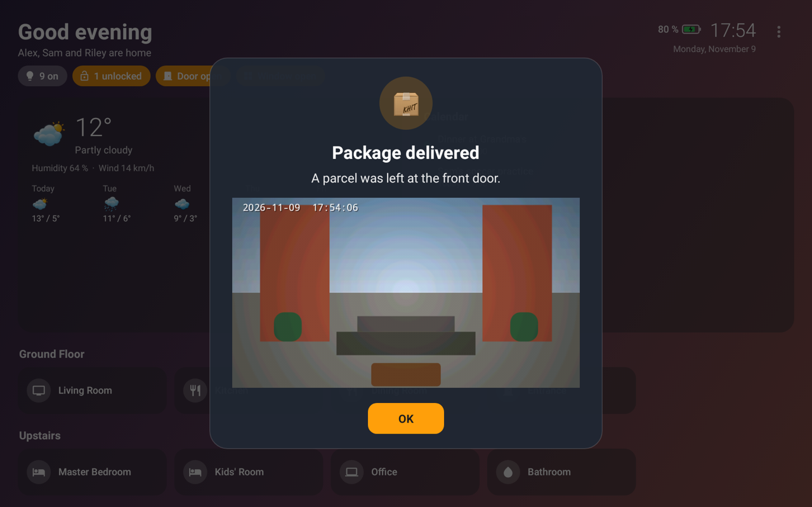

**Notification center.** A notification stays on screen for at most **30 seconds** (configurable in *Display → Notifications*,
on the web page, or with the number entity *Notification duration*; a shorter `duration` from the automation wins). If nobody taps
**OK**, it stays **unread** and a **bell** with a red counter appears next to the time. Tap the bell to see every unread
notification, newest first:

- tap one to open it again (it becomes read and leaves the list);
- **Select** (or long‑press a notification), tick several, then **Mark as read**;
- **Mark all as read**.

Unread notifications are kept across restarts and updates (50 at most). The sensor *Unread notifications* gives their number to
Home Assistant, e.g. to light a lamp while messages are waiting. Emoji newer than the tablet supports are shown as 💬.

The device stays the same even if you reinstall the app or move your configuration to another tablet (its ID is kept in backups).

### Demo mode

Turn on **Demo mode** (tablet: *Settings → Connection*; web page: *Connection & security*), or tap **Try the demo** on the welcome
screen. TileHouse then shows a fictional house with 10 rooms, about 70 devices, cameras, weather, calendars and people. Everything
reacts to touch, but nothing leaves the tablet. Your own configuration is kept aside and comes back as soon as you leave the demo
(or save a real Home Assistant connection).

### Backup and restore

In the web page (*Connection & security → Backup*), **Export configuration** downloads a JSON file with your rooms, devices, custom names,
order, home screen and display settings. Secrets are excluded unless you tick the box. **Restore a backup…** applies such a file:
handy after a reinstall or to set up a second tablet.

### Languages

The interface, the web page and the MQTT entity names are available in **English** and **French**. By default TileHouse follows the
tablet's language; you can force one in *Display → Language*.

---

## Updating over Wi‑Fi

TileHouse checks GitHub for a new release **every 6 hours**. There are three ways to install it:

1. **From Home Assistant**: the **TileHouse** update entity shows the new version. Click **Install**.
2. **From the tablet**: *Settings → About → Updates → Install*.
3. **From the web page**: *About → Update*. Use **Check for updates** / **Install**, or **Upload an APK…** to send an
   APK file directly from your computer (useful for test builds or without internet access).

Android always asks for a **confirmation on the tablet** (one tap on *Install*). The very first time, Android also asks you to allow
TileHouse to install apps: turn on **Allow from this source**, go back, and start the update again.

**Google Play Protect** may also step in, because TileHouse is not distributed through the Play Store. Choose **Scan app**: the APK is
checked by Google and the installation continues. Depending on the Play Protect version, *More details → Install anyway* may also be offered.
TileHouse reopens by itself once the update is installed.

> **"Harmful app blocked"?** Play Protect is wary of new apps that are not on the Play Store and that can install updates
> themselves, so it may block over‑the‑air updates even when installing the same APK by hand works. Two fixes:
> - install the new APK by hand once (download it from the releases page in the tablet's browser and open it), or
> - on a dedicated wall tablet, turn off scanning: *Play Store → profile picture → Play Protect → ⚙️ → Scan apps with Play Protect*.
>   Wi‑Fi updates then install normally. You can turn it back on at any time.

> Updates must be signed with the same key as the installed app. Official releases are all signed with the same release key, so
> they always install over each other. If you build the app yourself with a different key, uninstall the official app first
> (export your configuration before).

---

## Security and privacy

- TileHouse talks **only** to your Home Assistant, your MQTT broker, and GitHub (to check for updates). No analytics, no accounts, no cloud.
- The Home Assistant token, the MQTT password and the PIN are **encrypted at rest** with a key kept in the Android Keystore.
  They are never displayed again once saved, and never included in a backup unless you ask for it.
- **Wake on motion** is off by default. When you turn it on, the front camera's frames are compared in memory at very low resolution
  and thrown away: nothing is recorded, saved or sent.
- The web page requires the **PIN** when one is set (5 wrong attempts lock it for a while). Use a PIN on any shared network.
- The web page only accepts JSON requests from itself (basic CSRF protection) and can only be embedded in a frame by Home Assistant.
- Traffic to Home Assistant uses whatever you configure: use `https://` if your instance supports it.

---

## Performance

TileHouse was written for old tablets with little memory:

- Native Android views only (no WebView, no Jetpack Compose, no AppCompat); about **35–60 MB** of RAM in use.
- Home Assistant's `subscribe_entities` with a filter: the tablet only receives the entities it displays, in compressed form.
- Large responses are parsed in a streaming way and trimmed; the full device list is only loaded while you edit rooms.
- Snapshots are decoded at screen size in RGB_565, and only refreshed while visible.
- The video player is only loaded when you open a live view, and released when you close it.

---

## Building from source

Requirements: JDK 17 and the Android SDK (platform 36).

```bash
git clone https://github.com/gharl77/TileHouse.git
cd TileHouse
./gradlew assembleRelease          # signed with the debug key
adb install -r app/build/outputs/apk/release/app-release.apk
```

To sign with your own release key, create `keystore.properties` at the project root (it is git‑ignored):

```properties
storeFile=keystore/release.jks
storePassword=…
keyAlias=…
keyPassword=…
```

then build with `./gradlew assembleRelease -Pdistribution`.

The version is set in [`app/build.gradle.kts`](app/build.gradle.kts) (`appVersion`); the version code is derived from it.

---

## Versioning

TileHouse uses **calendar versioning**: `YEAR.MONTH.N`, where `N` is the release number within that month.
`2026.11.1` is the first release of November 2026. See the [changelog](CHANGELOG.md).

---

## License

[MIT](LICENSE) © 2026 gharl77

TileHouse is not affiliated with Home Assistant, Nabu Casa or Apple. "Home Assistant" is a trademark of its respective owner.
